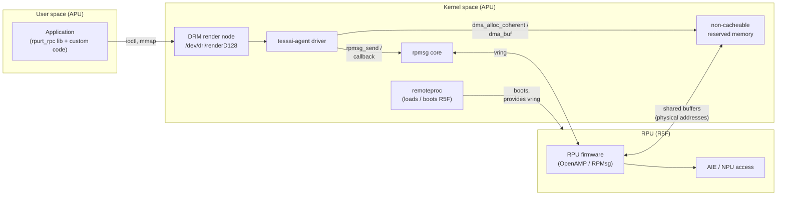
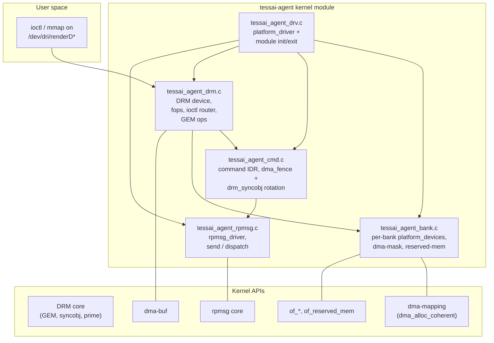
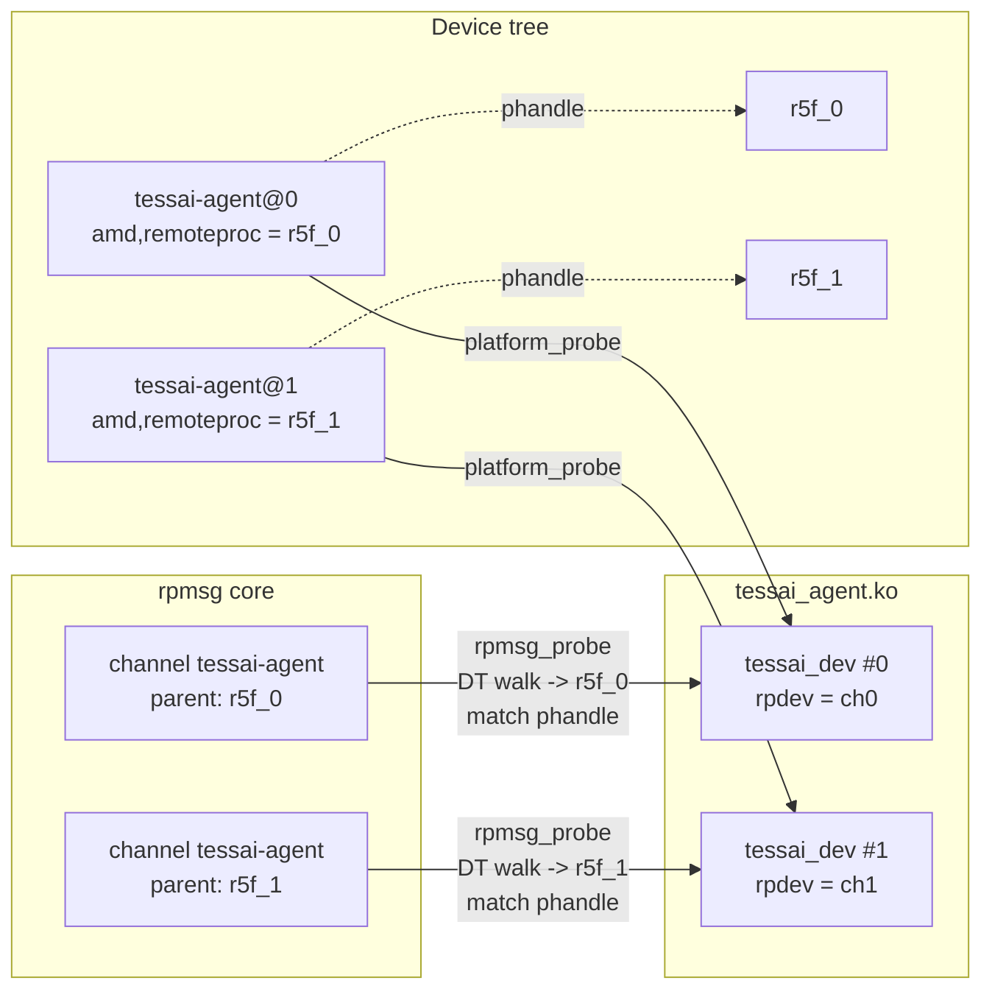
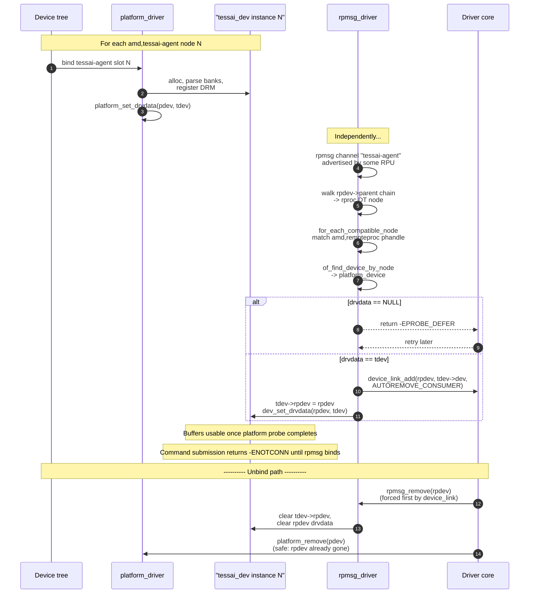
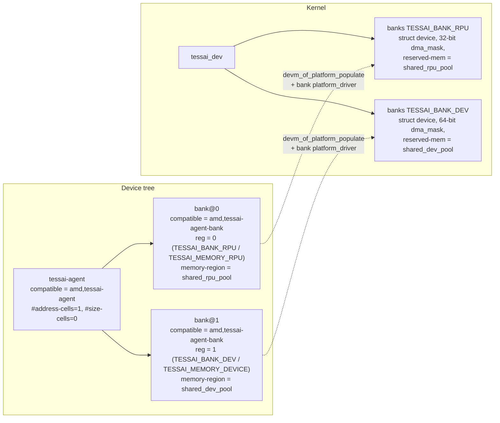

# Overall Architecture

This document describes the end-to-end architecture of the
`tessai-agent` driver: how the kernel module is structured, how it sits
between userspace and the RPU, and how data and control flow through
the major subsystems.

> The simpler `rpurt-rpc` driver under `drivers/misc/rpurt-rpc/` is a
> minimal placeholder that pre-dates `tessai-agent`. Everything below
> describes the real driver under `drivers/misc/tessai-agent/`.

---

## 1. System view

The driver lives on the Application Processor Unit (APU) and brokers
communication between userspace processes on the APU and a Real-time
Processor Unit (RPU, e.g. an R5F) running an embedded runtime that
handles the actual hardware (AIE/NPU, sensors, etc.).



**Key idea.** Buffer memory is shared between the APU and the RPU through
**non-cacheable** reserved-memory regions described in device tree (banks are
not marked `dma-coherent`, so `dma_alloc_coherent()` returns non-cacheable
normal memory). The driver translates GEM handles into physical addresses and
hands them to the RPU as part of submission arguments. Control messages (wire
commands and responses/events) flow over rpmsg.

---

## 2. Driver-internal block diagram



| File | Responsibility |
|------|----------------|
| `tessai_agent_drv.c` | Module init/exit, registration of three handlers: parent `platform_driver` (matches `amd,tessai-agent`), bank `platform_driver` (matches the single shared `amd,tessai-agent-bank`), and `rpmsg_driver` (matches channel `tessai-agent`). The parent probe publishes drvdata then calls `devm_of_platform_populate()`. |
| `tessai_agent_bank.c` | Implements the bank `platform_driver`. Each probe reads `reg` (the logical bank index — `0`=RPU, `1`=device), owns one bank's reserved-memory + dma-mask (32 for rpu, 64 for dev with 32-bit fallback) and registers itself into `tdev->banks[reg]`. |
| `tessai_agent_drm.c` | Owns the DRM render node. Custom `unlocked_ioctl` routes magic-`'M'` ioctls to our handlers and falls through to `drm_ioctl()` for syncobj/prime/GEM ioctls. Implements GEM `alloc/import/export/mmap` against per-bank devices. |
| `tessai_agent_cmd.c` | Command lifecycle, command IDR, single `dma_fence` per submission on `drm_syncobj`, `tessai_cmd_dispatch_response()` from rpmsg. |
| `tessai_agent_rpmsg.c` | `rpmsg_driver` registration, `rpmsg_send()` for outgoing `tessai_wire_cmd`, callback that decodes `tessai_wire_rsp` and feeds it to `tessai_cmd_dispatch_response()`. |

---

## 3. Multiple instances, two driver halves each

A single APU may host several RPUs - for example one R5F per cluster -
and each gets its own `amd,tessai-agent` device-tree node pointing at
its own remoteproc via `amd,remoteproc`. The driver fully supports
this: every instance gets its own DRM render node, its own pair of
banks, and its own rpmsg channel.



The kernel module registers **three** handlers, regardless of how many
instances are present:

| Handler | Multiplicity | Match by |
|---------|-------------|----------|
| parent `platform_driver` | one probe per `tessai-agent` DT node | `compatible = "amd,tessai-agent"` |
| bank `platform_driver`   | two probes per parent (one per bank child; role from `reg`) | `compatible = "amd,tessai-agent-bank"` |
| `rpmsg_driver`           | one probe per RPU advertising the channel | `id_table.name = "tessai-agent"` |

The two halves find each other entirely through the device tree - no
global registry, no pending list, no driver-internal book-keeping.
When an rpmsg channel comes up:

1. Walk the rpmsg device's parent chain to find the first ancestor
   with an `of_node`. That node is the underlying **remoteproc** (the
   target of the `amd,remoteproc` phandle).
2. `for_each_compatible_node(np, NULL, "amd,tessai-agent")` - for each
   match, dereference its `amd,remoteproc` phandle and compare to the
   node from step 1.
3. Once the matching node is found, `of_find_device_by_node()` returns
   its `platform_device`. The `tessai_dev` pointer is at
   `platform_get_drvdata(pdev)`.
4. If the platform device is not yet bound (`drvdata == NULL`),
   the rpmsg probe returns **`-EPROBE_DEFER`** and the driver core
   retries later.
5. Otherwise we install a managed `device_link` from the rpmsg device
   (consumer) to the platform device (supplier). This guarantees that
   on platform unbind, our `rpmsg_remove()` runs **before**
   `tessai_platform_remove()`, so the platform side never sees a live
   `tdev->rpdev` pointer.



In the fast path, `tessai_rpmsg_cb()` recovers the owning `tessai_dev`
with one `dev_get_drvdata(&rpdev->dev)` call - no lock, no list walk
per message.

Either half can come up first per-instance:

- **Platform first** (typical): buffers usable immediately. The rpmsg
  channel attaches whenever the RPU firmware boots and announces it.
- **Rpmsg first**: rpmsg probe returns `-EPROBE_DEFER`; the driver
  core re-runs it once the matching platform device finishes probing.

This decoupling matters because remoteproc may be loaded long after
the kernel boots and userspace has already opened the device.

---

## 4. Memory bank layout

The driver requires exactly two memory banks, modelled as DT child
nodes of the parent:



Why per-bank platform devices? GEM allocations call
`dma_alloc_coherent(bank->dev, ...)` (see
`drivers/misc/tessai-agent/tessai_agent_drm.c`).
Each bank has its own `struct device` so:

1. The dma-mask is honoured per allocation. The RPU bank refuses
   addresses above 4 GiB; the dev bank goes up to its full 64-bit
   window.
2. The reserved-memory carve-out attached via
   `of_reserved_mem_device_init_by_idx()` is local to that bank, so the
   two pools never bleed into each other.
3. dma-buf imports re-attach the imported `dma_buf_attachment` to the
   bank's device, so the kernel re-maps the SG list within the bank's
   addressable window when needed.

`enum tessai_memory_type` selects the bank for `TESSAI_BUF_ALLOC`:

| Value | Name | Bank |
|-------|------|------|
| `0` | `TESSAI_MEMORY_RPU` | RPU (`bank@0`, `TESSAI_BANK_RPU`) 32-bit pool |
| `1` | `TESSAI_MEMORY_DEVICE` (`TESSAI_MEMORY_DEFAULT`) | Dev (`bank@1`, `TESSAI_BANK_DEV`) 64-bit pool (default) |

PRIME imports attach to the dev bank device in `tessai_gem_prime_import_sg_table()`.

`TESSAI_MEMORY_DEFAULT` expands to `TESSAI_MEMORY_DEVICE`, so callers using the macro get the dev bank without naming the constant explicitly.

If userspace passes `memory_type = TESSAI_MEMORY_DEVICE` (including via `TESSAI_MEMORY_DEFAULT`), the driver uses the dev bank.

---

## 5. Userspace surface

The driver presents itself as a DRM render node
(`/dev/dri/renderD<N>`). Userspace gets:

- **Per-process handle space.** GEM handles (`drm_handle`) from
  `TESSAI_BUF_ALLOC` and PRIME import are scoped to the open `drm_file`.
- **mmap.** `mmap(drm_fd, size, ..., offset)` with the offset returned
  by `DRM_IOCTL_GEM_MMAP` (the standard DRM mmap dance). The driver's
  GEM `mmap` op forwards to `dma_mmap_coherent()` (native) or the
  exporter (imports).
- **dma-buf interop.** Standard `DRM_IOCTL_PRIME_HANDLE_TO_FD` and
  `DRM_IOCTL_PRIME_FD_TO_HANDLE` on the render node; imports attach to
  the dev bank.
- **Sync waits.** `TESSAI_CMD_SUBMIT` returns a `drm_sync_obj_handle` in
  `struct tessai_cmd_submit`; userspace waits with
  `DRM_IOCTL_SYNCOBJ_WAIT` (or `HANDLE_TO_FD` + `poll()`/`epoll()`) and
  uses `DRM_IOCTL_SYNCOBJ_QUERY` / sync_file probes for fence status.
  Convenience wrappers live in **`libtessai_agent`** (see [`lib-userspace-flow.md`](lib-userspace-flow.md)).
- **DRM syncobj (binary only).** `DRIVER_SYNCOBJ` is advertised; the
  driver does not enable `DRIVER_SYNCOBJ_TIMELINE`. Returned completion
  handles are single-fence (binary) syncobjs; userspace can still combine
  waits with other DRM devices in multi-handle waits where the API allows.
- **Unknown response types.** RPMsg payloads whose `command_rsp_type` is not
  one of the terminal `TESSAI_RSP_*` enums handled in
  `tessai_cmd_dispatch_response()` are ignored at log level.

---

## 6. Code reference

The most relevant entry points:

```c
struct tessai_dev {
	struct drm_device	drm;
	struct device		*dev;

	struct tessai_bank	banks[TESSAI_NUM_BANKS];

	struct rpmsg_device	*rpdev;
	struct mutex		rpmsg_lock;

	struct mutex		cmd_lock;
	struct idr		cmd_idr;
	atomic_t		fence_seqno;
	u64			fence_context;
};
```

The platform probe assembles all of the above:

See **`tessai_platform_probe()`** in
[`drivers/misc/tessai-agent/tessai_agent_drv.c`](../drivers/misc/tessai-agent/tessai_agent_drv.c)
for the actual sequence:

1. Parse `amd,remoteproc`.
2. Allocate `tessai_dev` (devm DRM).
3. Init command lifecycle.
4. **`platform_set_drvdata(pdev, tdev)`** — bank probes need this.
5. **`devm_of_platform_populate(dev)`** — triggers synchronous bank probes
   for both `bank@0` and `bank@1` (single shared compatible
   `amd,tessai-agent-bank`; role taken from `reg`).
6. **`tessai_bank_check_all_present(tdev)`** verifies both slots are populated.
7. **`tessai_drm_register(tdev)`** publishes the render node.

---

## 7. See also

- [`commands.md`](commands.md) — command submission, the two-state
  lifecycle, and the rotating fence behind every command's syncobj.
- [`buffer-management.md`](buffer-management.md) — buffer allocation,
  import, export, mmap and lifetime details.
