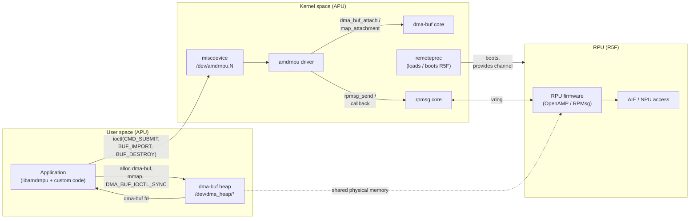
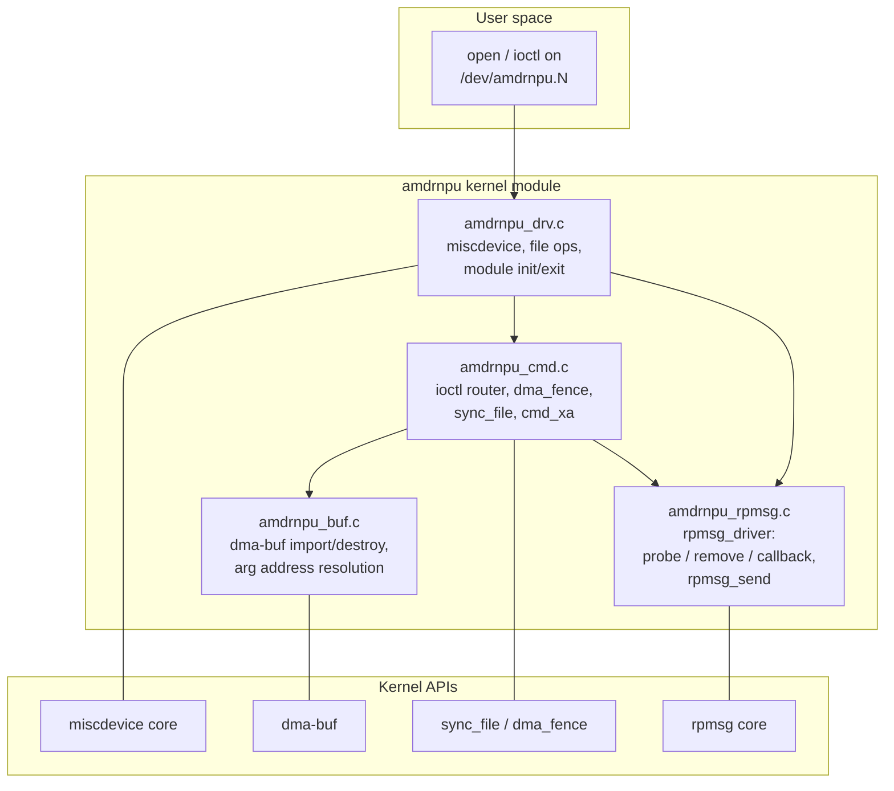

# Overall Architecture

This document describes the end-to-end architecture of the
`amdrnpu` driver: how the kernel module is structured, how it sits
between userspace and the RPU, and how data and control flow through
the major subsystems.

Everything below describes the driver under
[`drivers/rpmsg/amdrnpu/`](../drivers/rpmsg/amdrnpu/).

`amdrnpu` is a **lightweight rpmsg char driver**, not a DRM driver. It
exposes a miscdevice (`/dev/amdrnpu.N`), imports userspace-allocated
dma-buf objects, forwards opaque commands to firmware over rpmsg, and
reports completion through a per-command `dma_fence` exported as a
`sync_file` fd.

---

## 1. System view

The driver lives on the Application Processor Unit (APU) and brokers
communication between userspace processes on the APU and a Real-time
Processor Unit (RPU, e.g. an R5F) running an embedded runtime that
handles the actual hardware (AIE/NPU, sensors, etc.).



**Key idea.** Buffer memory is **allocated in userspace** from a dma-buf
heap (e.g. `/dev/dma_heap/reserved`) and shared with the RPU. Userspace
imports each dma-buf into the driver with **`AMDRNPU_BUF_IMPORT`**; the
driver attaches it to the appropriate DMA domain, verifies it is
physically contiguous, and records its DMA address. When the buffer is
used as a command argument, the driver emits that DMA address on the
wire. CPU mapping and cache maintenance are performed by userspace on
the dma-buf fd directly (`mmap(2)`, `DMA_BUF_IOCTL_SYNC`), not through
this driver. Control messages (wire commands and responses) flow over
rpmsg.

---

## 2. Driver-internal block diagram



| File | Responsibility |
|------|----------------|
| `amdrnpu_drv.c` | miscdevice registration (`misc_register`, `/dev/amdrnpu.N`), file `open`/`release`, `unlocked_ioctl`/`compat_ioctl` hooks, per-`amdrnpu_dev` refcounting, and module init/exit (which register/unregister the rpmsg driver). Sets a 64-bit DMA mask on the misc device so >32-bit device buffers are not bounced. |
| `amdrnpu_rpmsg.c` | The `rpmsg_driver` bound to channel `"amdrnpu"`. `probe` allocates one `struct amdrnpu_dev`, names it `amdrnpu.<idx>`, registers the miscdevice, and records the remoteproc device (for the FW DMA domain). `remove` deregisters the node and drains in-flight commands. `callback` decodes the `amdrnpu_wire_rsp` and dispatches it. `amdrnpu_rpmsg_send_cmd()` sends `amdrnpu_wire_cmd`. |
| `amdrnpu_cmd.c` | Command lifecycle: the `amdrnpu_ioctl` switch; per-submission `dma_fence` wrapped in a `sync_file`; **driver-owned command ids** in `cmd_xa` (`xa_alloc_cyclic`, wire `seq`); argument resolution (`amdrnpu_resolve_args`); response dispatch and drain. Completion is asynchronous with many commands in flight. |
| `amdrnpu_buf.c` | `AMDRNPU_BUF_IMPORT` / `AMDRNPU_BUF_DESTROY`: `dma_buf_get` + `dma_buf_attach` + `dma_buf_map_attachment`, physical-contiguity check, per-client handle table (`buf_xa`), and kref-based buffer lifetime. |

---

## 3. Instances and rpmsg binding

There is **no platform driver and no device-tree binding for
`amdrnpu`**. The driver is purely an rpmsg client: it registers one
`rpmsg_driver` whose `id_table` matches the channel name **`amdrnpu`**.
A `struct amdrnpu_dev` — and therefore a `/dev/amdrnpu.N` node — comes
into existence when RPU firmware advertises that channel and the rpmsg
core probes the driver.

A single APU may host several RPUs (for example one R5F per cluster).
Each RPU that advertises the `amdrnpu` channel gets its own
`amdrnpu_dev` and its own miscdevice node. Node indices are assigned
from a module-global atomic counter, so nodes appear as
`/dev/amdrnpu.0`, `/dev/amdrnpu.1`, … in bind order.

```mermaid
sequenceDiagram
    autonumber
    participant RPROC as remoteproc (R5F)
    participant RPMSG as rpmsg core
    participant RDR as amdrnpu rpmsg_driver
    participant DEV as amdrnpu_dev
    participant MISC as miscdevice core

    RPROC->>RPMSG: firmware boots, announces channel "amdrnpu"
    RPMSG->>RDR: probe(rpdev)
    RDR->>DEV: kzalloc, kref_init,<br/>cmd_init, rpdev = rpdev
    RDR->>DEV: dev_name = "amdrnpu.<idx>"
    RDR->>MISC: misc_register(MISC_DYNAMIC_MINOR)
    MISC-->>RDR: /dev/amdrnpu.<idx>
    RDR->>DEV: rproc_dev = first DT ancestor of rpdev<br/>(get_device)
    RDR->>RPMSG: dev_set_drvdata(rpdev, dev)

    Note over DEV: node openable; commands flow once channel is live

    Note over RPMSG,MISC: ---------- unbind path ----------
    RPMSG->>RDR: remove(rpdev)
    RDR->>MISC: misc_deregister
    RDR->>DEV: rpdev = NULL (under rpmsg_lock)
    RDR->>DEV: drain in-flight cmds with -ENOTCONN
    RDR->>DEV: amdrnpu_dev_put (drop binding's ref)
```

In the fast path, `amdrnpu_rpmsg_cb()` recovers the owning
`amdrnpu_dev` with one `dev_get_drvdata(&rpdev->dev)` call — no lock, no
list walk per message.

### Reference counting

`struct amdrnpu_dev` is `kref`-counted. The rpmsg binding holds one
reference for as long as the channel is bound; each open file
descriptor holds an additional reference. The device is freed (and the
remoteproc device reference released) only when the last reference
drops, so an open fd keeps the object valid across an rpmsg unbind —
subsequent ioctls simply fail once `rpdev` is `NULL`.

---

## 4. DMA domains

Imported buffers are attached to one of two devices, selected by the
`flags` field of `struct amdrnpu_buf_import`:

| `flags` | Attach device | Emitted DMA address |
|---------|---------------|---------------------|
| `AMDRNPU_BUF_IMPORT_DEVICE` (`0`, default) | the misc device (`mdev.this_device`) | accelerator/device view |
| `AMDRNPU_BUF_IMPORT_FW` (`1<<0`) | the remoteproc device (`rproc_dev`) | the address the RPU dereferences |

The misc device carries a 64-bit DMA mask
(`dma_coerce_mask_and_coherent(DMA_BIT_MASK(64))`) so device-domain
buffers above 4 GiB are not bounced. The firmware domain uses the
remoteproc platform device, discovered by walking up the rpmsg
channel's parent chain to the first ancestor with a device-tree node:

```c
static struct device *amdrnpu_rproc_dev(struct rpmsg_device *rpdev)
{
	struct device *dev;

	for (dev = rpdev->dev.parent; dev; dev = dev->parent)
		if (dev_of_node(dev))
			return dev;
	return NULL;
}
```

If no such ancestor exists (non-DT platforms), FW-domain imports return
`-ENODEV`.

Because the driver only *imports* dma-bufs, it never allocates backing
memory and never performs cache maintenance. The heap the userspace
buffer came from determines its physical placement and reachability;
for RPU-visible buffers, userspace must allocate from an RPU-reachable,
physically contiguous pool.

---

## 5. Userspace surface

The driver presents itself as a miscdevice (`/dev/amdrnpu.N`). Userspace
gets:

- **Three ioctls** (magic `'R'`, ABI v1):
  - **`AMDRNPU_BUF_IMPORT`** — import a dma-buf fd, returns a per-file
    `handle`.
  - **`AMDRNPU_BUF_DESTROY`** — release a `handle`.
  - **`AMDRNPU_CMD_SUBMIT`** — submit a command; returns a `sync_handle`
    (a `sync_file` fd).
- **Per-file handle space.** Buffer handles from `AMDRNPU_BUF_IMPORT`
  are scoped to the open file (`struct amdrnpu_client.buf_xa`) and freed
  on `close()`.
- **CPU mapping and cache sync happen on the dma-buf**, not the device
  node: `mmap(2)` and `DMA_BUF_IOCTL_SYNC` on the dma-buf fd. The
  library hides this behind `amdrnpu_buf_mmap()` / `amdrnpu_buf_sync()`.
- **Completion via sync_file.** `AMDRNPU_CMD_SUBMIT` returns a
  `sync_file` fd in `sync_handle`; userspace waits with `poll(2)` for
  `POLLIN`, or via the `amdrnpu_syncobj_*` wrappers in **`libamdrnpu`**
  (see [`lib-userspace-flow.md`](lib-userspace-flow.md)). The fence
  error (if any) is read via `SYNC_IOC_FILE_INFO`.
- **Unknown response types.** RPMsg payloads whose `command_rsp_type`
  is outside the known `AMDRNPU_RSP_*` range are logged and complete the
  command with `-EREMOTEIO`.

---

## 6. Code reference

The central per-channel state:

```c
struct amdrnpu_dev {
	struct kref		refcount;
	struct miscdevice	mdev;
	struct device		*dev;		/* mdev.this_device; for logging */
	struct device		*rproc_dev;	/* FW-buffer DMA domain */

	struct rpmsg_device	*rpdev;
	struct mutex		rpmsg_lock;	/* rpmsg send path */

	struct mutex		cmd_lock;	/* cmd_xa alloc/erase */
	struct xarray		cmd_xa;		/* in-flight cmds; xa_alloc_cyclic */
	u32			cmd_xa_next;	/* cyclic cursor */
	atomic_t		fence_seqno;
	u64			fence_context;

	char			dev_name[32];
};
```

The rpmsg probe assembles all of the above — see
**`amdrnpu_rpmsg_probe()`** in
[`drivers/rpmsg/amdrnpu/amdrnpu_rpmsg.c`](../drivers/rpmsg/amdrnpu/amdrnpu_rpmsg.c):

1. Allocate `amdrnpu_dev`, `kref_init`, init the command bookkeeping.
2. Record `rpdev` and assign `dev_name = "amdrnpu.<idx>"`.
3. **`amdrnpu_chardev_register()`** — `misc_register()`, publish
   `/dev/amdrnpu.<idx>`, set the 64-bit DMA mask.
4. Resolve and pin `rproc_dev` (the FW DMA domain).
5. `dev_set_drvdata(rpdev, rnpu)` so the callback can find the device.

---

## 7. See also

- [`commands.md`](commands.md) — command submission, the async
  many-in-flight lifecycle, and the per-command `sync_file`.
- [`buffer-management.md`](buffer-management.md) — dma-buf import,
  handle scoping, and in-flight command pins.
- [`devicetree-binding.md`](devicetree-binding.md) — how the rpmsg
  channel and buffer heaps are wired into device tree.
