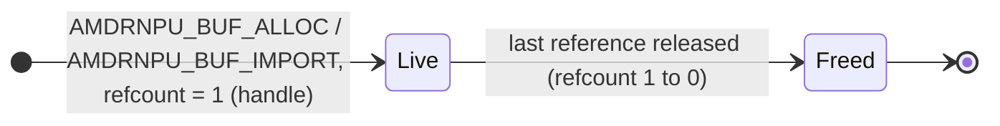
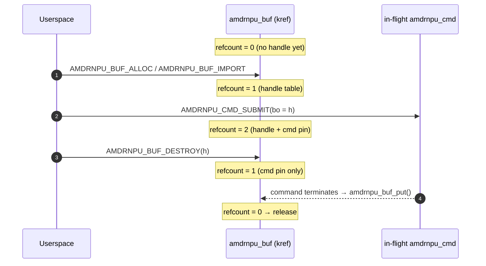
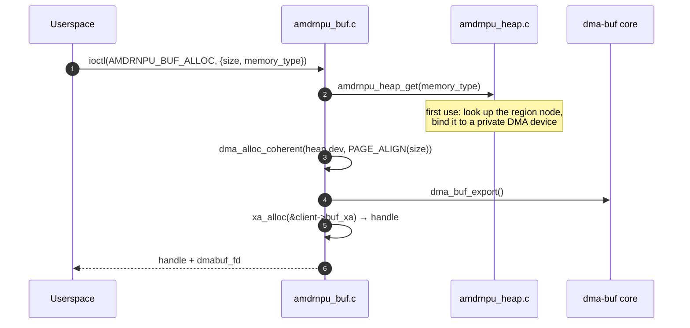

# Buffer Management

This document describes how userspace obtains, references, and releases
buffers through the `amdrnpu` driver.

A buffer handle comes from one of two ioctls:

- **`AMDRNPU_BUF_ALLOC`** — the driver allocates a physically
  contiguous buffer from the reserved-memory region configured for the
  requested memory type, exports it as a dma-buf, and returns both a
  handle and the dma-buf fd. This is what the library's
  **`amdrnpu_buf_alloc()`** uses.
- **`AMDRNPU_BUF_IMPORT`** — userspace brings a dma-buf allocated
  elsewhere (a dma-buf heap, another driver). The driver attaches it to
  a DMA domain, verifies it is physically contiguous, and returns a
  handle.

Either way the driver records the buffer's DMA address and returns an
opaque per-file **handle**. That handle is what a `struct amdrnpu_arg`
buffer slice refers to; the driver programs `dma_addr + offset` on the
wire when the buffer is used by a command.

CPU mapping and cache maintenance are performed by userspace **on the
dma-buf fd** (`mmap(2)`, `DMA_BUF_IOCTL_SYNC`), not through the device
node. The library wraps this in `amdrnpu_buf_mmap()` /
`amdrnpu_buf_sync()`.

**Userspace helpers:** [`lib-userspace-flow.md`](lib-userspace-flow.md)
covers **`amdrnpu_buf_alloc()`**, **`amdrnpu_buf_close()`**,
**`amdrnpu_buf_mmap()`**, and **`amdrnpu_buf_sync()`**, and how they
line up with the ioctl flow below.

Each buffer is **reference-counted** (`struct amdrnpu_buf`, `kref`). The
per-client handle table owns one reference; each in-flight command that
references the buffer holds another. The buffer is torn down only when
the last reference is dropped — **not** necessarily when the handle is
destroyed.

---

## 1. Lifecycle overview

A buffer is **`Live`** from `AMDRNPU_BUF_ALLOC` / `AMDRNPU_BUF_IMPORT`
until its last reference is released. `AMDRNPU_BUF_DESTROY` (or file
close) drops the handle-table reference; if a command still pins the
buffer, it survives until that command completes.



| Holder | Acquired by | Released by |
|---|---|---|
| Handle-table entry | `AMDRNPU_BUF_ALLOC` / `AMDRNPU_BUF_IMPORT` (one ref) | **`AMDRNPU_BUF_DESTROY`** / **`amdrnpu_buf_close()`**, or implicit teardown on `close()` of the device fd |
| In-flight command pin | `AMDRNPU_CMD_SUBMIT` with a buffer arg (`size != 0`) | Terminal `AMDRNPU_RSP_*`, submit-failure cleanup, or drain on channel unbind / module unload (see §5) |



---

## 2. Allocation: `AMDRNPU_BUF_ALLOC`



**Inputs and outputs (`struct amdrnpu_buf_alloc`):**

| Field | Meaning |
|-------|---------|
| `size` | allocation size in bytes, rounded up to a whole page |
| `memory_type` | `AMDRNPU_MEMORY_RPU` or `AMDRNPU_MEMORY_DEVICE` (see below) |
| `flags` | reserved, must be 0 |
| `handle` | must be 0 on entry; **output**: opaque per-file handle for `amdrnpu_arg.bo.buffer_handle` |
| `dmabuf_fd` | must be 0 on entry; **output**: dma-buf fd for `mmap(2)`, `DMA_BUF_IOCTL_SYNC`, and sharing |

**Memory regions.** Each memory type is backed by one
`shared-dma-pool` node under `/reserved-memory`, looked up by **node
name** (no device-tree changes or labels are required). Both reusable
(CMA) and `no-map` pools are supported.

| `memory_type` | configfs attribute | Default node | DMA domain |
|---|---|---|---|
| `AMDRNPU_MEMORY_RPU` (`0`) | `/sys/kernel/config/amdrnpu/rpu_region` | `rpu_gem_cma` | the remoteproc device's, 32-bit mask — the address the RPU dereferences |
| `AMDRNPU_MEMORY_DEVICE` (`1`) | `/sys/kernel/config/amdrnpu/device_region` | `buffer` | 64-bit mask — the accelerator view |

A name without `@` matches the node name with any unit address
(`rpu_gem_cma` matches `rpu_gem_cma@20000000`); if more than one node
matches, use the full name. A region is bound on the first allocation
of its type and stays bound until the rpmsg channel is removed and the
last user of the device (open fd or allocated buffer) is gone; while it
is bound, writing its configfs attribute fails with `-EBUSY`. To use a
different region, write the attribute before the first allocation:

```sh
echo rpu_gem_cma@20000000 > /sys/kernel/config/amdrnpu/rpu_region
```

**Failure modes:** `-EFAULT`; `-EINVAL` (non-zero `flags` / `handle` /
`dmabuf_fd`, `size` of 0 or over 4 GiB minus one page, unknown
`memory_type`, or an
ambiguous region name); `-ENODEV` (region not found, or not an
initialised `shared-dma-pool`); `-ENOMEM` (region exhausted).

---

## 3. Import: `AMDRNPU_BUF_IMPORT`


**Inputs (`struct amdrnpu_buf_import`):**

| Field | Meaning |
|-------|---------|
| `fd` | dma-buf fd to import (must be ≥ 0) |
| `flags` | target DMA domain: `AMDRNPU_BUF_IMPORT_DEVICE` (0, default) or `AMDRNPU_BUF_IMPORT_FW` (`1<<0`); all other bits reserved |
| `handle` | **output**: opaque per-file handle for `amdrnpu_arg.bo.buffer_handle` |
| `pad` | reserved, must be 0 |

The imported buffer **must be physically contiguous** — the driver
walks the mapped scatter-gather table and requires a single continuous
DMA run (`amdrnpu_sgt_dma_contig()`); otherwise import fails with
`-EINVAL`. This lets the driver hand the RPU a single base address.

**Domain selection.** `AMDRNPU_BUF_IMPORT_FW` attaches the buffer to the
remoteproc device so the emitted DMA address is the one the RPU
dereferences; it fails with `-ENODEV` on non-DT platforms where no
remoteproc device was found. `AMDRNPU_BUF_IMPORT_DEVICE` (the default)
attaches to the accelerator misc device.

**Failure modes:** `-EFAULT`, `-EINVAL` (bad flags/pad/handle, or
non-contiguous), `-ENODEV` (FW domain unavailable), `-ENOMEM`, plus any
error from `dma_buf_get` / `dma_buf_attach` /
`dma_buf_map_attachment`.

---

## 4. CPU mapping and cache sync (on the dma-buf, not the driver)

Everything the CPU does with a buffer — mapping it, and cache
maintenance around device DMA — happens on the **dma-buf fd** using
standard kernel interfaces:

- **`mmap(2)`** on the dma-buf fd gives a CPU mapping.
- **`DMA_BUF_IOCTL_SYNC`** with `DMA_BUF_SYNC_START` /
  `DMA_BUF_SYNC_END` (and the `TO_DEVICE` / `FROM_DEVICE` direction
  bits) performs cache maintenance.

For an imported buffer, both are handled by its exporter. For a buffer
from `AMDRNPU_BUF_ALLOC`, the driver is the exporter: the memory comes
from `dma_alloc_coherent()`, so `mmap(2)` gives a coherent mapping and
`DMA_BUF_IOCTL_SYNC` has nothing to do (it succeeds as a no-op). Code
that brackets device DMA with sync calls works unchanged for both.

The library wraps these:

| Library helper | Underlying operation |
|----------------|----------------------|
| **`amdrnpu_buf_mmap()`** / **`amdrnpu_buf_munmap()`** | `mmap`/`munmap` on the dma-buf fd (`PROT_READ\|PROT_WRITE`, `MAP_SHARED`) |
| **`amdrnpu_buf_sync()`** and the **`_to_device()`** / **`_from_device()`** inline helpers | `DMA_BUF_IOCTL_SYNC` on the dma-buf fd |

> Note: `amdrnpu_buf_sync()`'s `offset`/`length` parameters are reserved
> — `DMA_BUF_IOCTL_SYNC` operates on the whole buffer — and
> `amdrnpu_buf_mmap()`'s `buf_size` parameter is reserved (the library
> tracks the allocation size internally). See the header for details.

Typical flow around a command that DMAs a userspace-filled input buffer:

1. CPU writes via the dma-buf mapping.
2. **`amdrnpu_buf_sync_to_device()`** (flush) before submit.
3. **`AMDRNPU_CMD_SUBMIT`** referencing the handle.
4. After completion, **`amdrnpu_buf_sync_from_device()`** (invalidate)
   before the CPU reads output.

---

## 5. In-flight command pins

A buffer referenced by a command argument (any `amdrnpu_arg` with
`size != 0`) is pinned by the driver for the command's lifetime.

```mermaid
sequenceDiagram
    autonumber
    participant U as Userspace
    participant SUB as AMDRNPU_CMD_SUBMIT
    participant CMD as amdrnpu_cmd
    participant BUF as amdrnpu_buf
    participant RPU as RPU firmware

    U->>SUB: ioctl(AMDRNPU_CMD_SUBMIT) with buffer arg (handle h)
    SUB->>BUF: amdrnpu_buf_get(client, h) → extra ref
    SUB->>BUF: bounds-check [offset, offset+size)
    SUB->>CMD: transfer ref into cmd->bo_refs[]
    SUB-->>U: sync_handle

    Note over U,BUF: BUF_DESTROY may run after submit returns; the pin keeps the buffer alive
    U->>BUF: AMDRNPU_BUF_DESTROY(h)
    Note over BUF: handle-table ref dropped; buffer survives via cmd pin

    RPU-->>CMD: terminal response over rpmsg
    CMD->>BUF: amdrnpu_buf_put() for each bo_ref
```

**At termination** the driver puts each `bo_refs[]` entry once. This
covers normal completions, error-class responses, submit-failure
cleanup, channel-unbind drain (`-ENOTCONN`), and module unload
(`-ENODEV`).

**Userspace:** after a successful submit you may call
**`AMDRNPU_BUF_DESTROY`** / **`amdrnpu_buf_close()`** as soon as you no
longer need the handle for your own lookups; the buffer stays alive
until the command finishes and drops its pin.

---

## 6. Release / cleanup

A buffer's handle-side state is torn down when its refcount reaches
**0**. Paths:

- **`AMDRNPU_BUF_DESTROY`** / **`amdrnpu_buf_close()`** on the handle
  (`xa_erase` + `amdrnpu_buf_put`).
- **`close(fd)`** on the device node walks the client's `buf_xa` and
  releases every remaining handle
  (`amdrnpu_client_buf_release()`).
- The final **command completion** dropping the last `bo_refs[]` pin.

When the last reference goes away, `amdrnpu_buf_release()` runs:

```c
if (buf->attach) {		/* imported buffers only */
	dma_buf_unmap_attachment_unlocked(buf->attach, buf->sgt, DMA_BIDIRECTIONAL);
	dma_buf_detach(buf->dmabuf, buf->attach);
}
dma_buf_put(buf->dmabuf);
```

For an allocated buffer, that `dma_buf_put()` drops only the driver's
own reference. The memory goes back to its region
(`dma_free_coherent()`) once every other dma-buf reference is gone too:
the `dmabuf_fd` returned by `AMDRNPU_BUF_ALLOC` (the library closes it
in `amdrnpu_buf_close()`), any `mmap(2)` mapping, and any other
importer. This can be after the device fd is closed.

While a command still pins a buffer, `AMDRNPU_BUF_DESTROY` only drops
the handle-table reference — the buffer survives until the submit
completes.

---

## 7. Userspace sketch

Using the library, which allocates through `AMDRNPU_BUF_ALLOC`:

```c
#include <errno.h>
#include <string.h>
#include <unistd.h>
#include <amdrnpu/amdrnpu_lib.h>

int main(void)
{
	int fd = open("/dev/amdrnpu.0", O_RDWR | O_CLOEXEC);
	uint32_t handle;
	uint64_t sz = 1u << 20;
	void *p;

	if (fd < 0)
		return 1;
	if (amdrnpu_buf_alloc(fd, AMDRNPU_MEMORY_DEVICE, sz, &handle))
		return 1;

	amdrnpu_buf_mmap(fd, handle, 0, 0, 0, &p);	/* whole buffer */
	memset(p, 0xa5, sz);
	amdrnpu_buf_sync_to_device(fd, handle, 0, 0);
	/* ... AMDRNPU_CMD_SUBMIT referencing handle ... */
	amdrnpu_buf_munmap(p, sz);
	amdrnpu_buf_close(fd, handle);
	close(fd);
	return 0;
}
```

A raw ioctl caller issues `AMDRNPU_BUF_ALLOC` itself, uses the returned
`dmabuf_fd` for `mmap`/`DMA_BUF_IOCTL_SYNC`, and when done calls
`AMDRNPU_BUF_DESTROY` and closes `dmabuf_fd`. To use memory from
elsewhere, it instead passes that dma-buf's fd to `AMDRNPU_BUF_IMPORT`.

---

## 8. See also

- [`architecture.md`](architecture.md) — the two DMA domains and how the
  driver allocates and imports dma-bufs.
- [`devicetree-binding.md`](devicetree-binding.md) — the reserved-memory
  regions behind each memory type.
- [`commands.md`](commands.md) — `amdrnpu_arg` buffer references and how
  they become wire DMA addresses.
- [`lib-userspace-flow.md`](lib-userspace-flow.md) — the library API for
  allocate, map, sync, and release.
