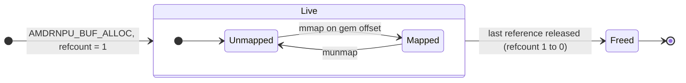
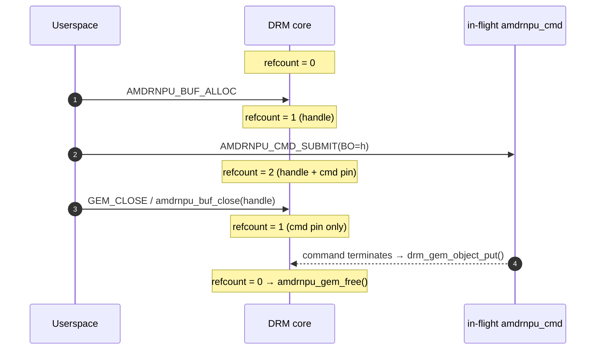
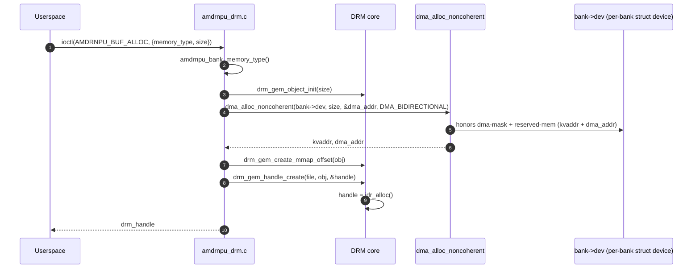
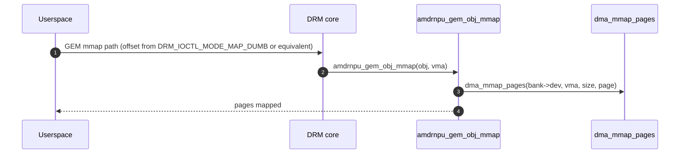
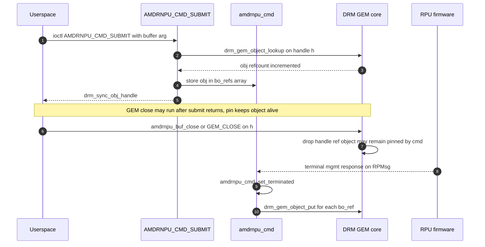
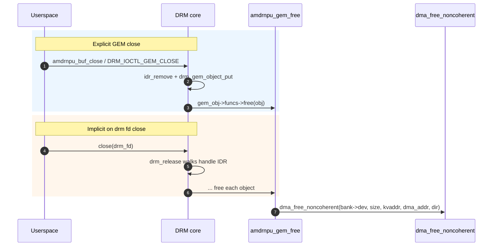

# Buffer Management

This document describes how userspace allocates, maps, and frees buffers
through the `amdrnpu` driver.

The driver uses **DRM GEM** as its buffer abstraction so it can use the
standard handle and mmap path. Each native buffer is backed by a contiguous
**cacheable** allocation (`dma_alloc_noncoherent()` on the per-bank struct
device) from a specific *memory bank* (RPU 32-bit or dev 64-bit). Userspace
must call **`AMDRNPU_BUF_SYNC`** (or **`amdrnpu_buf_sync()`**) to flush or
invalidate CPU cache lines around device DMA — see §3.

**Userspace helpers:** [`lib-userspace-flow.md`](lib-userspace-flow.md) covers
**`amdrnpu_buf_alloc()`**, **`amdrnpu_buf_close()`**, sync, mmap, and
how they line up with the ioctl flow below.

The buffer is **reference-counted**, the standard way GEM objects are managed.
The backing memory is freed only when the last reference is dropped — **not**
when any individual handle or command goes away. References are acquired and
released from several independent sources (handles, in-flight commands), and a
**GEM close** only decrements the count; whether memory is freed depends on
whether any *other* reference is still held.

---

## 1. Lifecycle overview

The buffer’s high-level state is **`Live`** vs **`Freed`**, with `mmap()` /
`munmap()` toggling mapping state inside **`Live`**. Leaving **`Live`** happens
when the GEM object’s refcount reaches zero.



While **`Live`**, refcount can rise and fall as holders acquire and release.
**No single close frees the buffer on its own** — only the holder that drops
the *last* reference triggers **`amdrnpu_gem_free()`**.

| Holder | Acquired by | Released by |
|---|---|---|
| DRM handle | `AMDRNPU_BUF_ALLOC` (one ref per handle) | **`amdrnpu_buf_close()`** / `DRM_IOCTL_GEM_CLOSE`, or implicit teardown on last `close()` of the DRM fd |
| In-flight command pin | `AMDRNPU_CMD_SUBMIT` with a buffer arg (`size != 0`) | Terminal `AMDRNPU_RSP_*`, submit-failure cleanup, driver drain / `amdrnpu_cmd_release`; see §5 |



---

## 2. Allocation: `AMDRNPU_BUF_ALLOC`



**Inputs (`struct amdrnpu_buf_alloc`):**

| Field | Meaning |
|-------|---------|
| `flags` | must be 0 |
| `memory_type` | `AMDRNPU_MEMORY_RPU` or `AMDRNPU_MEMORY_DEVICE` (default via `AMDRNPU_MEMORY_DEFAULT`) |
| `reserved0` | must be 0 |
| `size` | bytes; rounded up internally |
| `drm_handle` | **output**: GEM handle for this `drm_file` |

**Failure modes:** `-ENODEV`, `-EINVAL`, `-ENOMEM`.

---

## 3. Cache sync: `AMDRNPU_BUF_SYNC`

Native driver-allocated buffers are **cacheable**. Before the device reads CPU
writes, flush with **`AMDRNPU_BUF_SYNC_TO_DEVICE`**. After the device writes data
the CPU will read, invalidate with **`AMDRNPU_BUF_SYNC_FROM_DEVICE`**.

```c
struct amdrnpu_buf_sync {
    __u32 drm_handle;
    __u32 direction;   /* AMDRNPU_BUF_SYNC_TO_DEVICE or AMDRNPU_BUF_SYNC_FROM_DEVICE */
    __u32 flags;       /* must be 0 */
    __u64 offset;      /* byte offset into the buffer */
    __u64 length;      /* bytes; 0 = from offset through end-of-buffer */
};
```

Library wrappers: **`amdrnpu_buf_sync()`**, **`amdrnpu_buf_sync_to_device()`**,
**`amdrnpu_buf_sync_from_device()`**. PRIME-imported handles return
**`-EOPNOTSUPP`** — use the exporter’s sync rules.

Typical flow around a command that DMAs a userspace-filled input buffer:

1. CPU writes via `mmap` or kernel mapping.
2. **`AMDRNPU_BUF_SYNC_TO_DEVICE`** on the written range (often the whole buffer).
3. **`AMDRNPU_CMD_SUBMIT`** referencing the handle.
4. After completion, **`AMDRNPU_BUF_SYNC_FROM_DEVICE`** on output ranges before CPU read.

---

## 4. mmap

`mmap()` on the DRM fd uses the standard GEM mmap offset path. **`amdrnpu_buf_mmap()`**
wraps **`DRM_IOCTL_MODE_MAP_DUMB`** + **`mmap()`** (requires a **card** fd, not
renderD*). **Partial mmap** is supported: pass a page-aligned **`offset`** and
**`length`**; only that range is mapped (the driver maps `page + offset/PAGE_SIZE`).
**`offset`** and **`length`** must be page-aligned; **`length == 0`** maps from
**`offset`** through end-of-buffer and requires **`buf_size`** from allocation.
Unmap with **`amdrnpu_buf_munmap(addr, length)`**.



---

## 5. In-flight command pins

A buffer referenced by a command (any `amdrnpu_arg` with `size != 0`) is held
alive by the driver while that command runs.



**At termination** the driver puts each `bo_refs[]` entry once. That covers
normal completions, error-class responses, file teardown, and module unload
paths.

**Userspace:** after a successful submit you may call **`amdrnpu_buf_close`**
as soon as you no longer need the handle for your own lookups; the object stays
allocated until the command finishes and drops its pin.

---

## 6. Free / cleanup

A buffer is destroyed when refcount goes **1 → 0**. Typical paths:

- **`amdrnpu_buf_close()`** / **`DRM_IOCTL_GEM_CLOSE`** on the last open handle.
- **`close(drm_fd)`** walks the per-file handle table and closes GEMs.
- Command completion **`drm_gem_object_put`** when the last in-flight use ends.



While a command still pins a BO, **`GEM_CLOSE` only drops the userspace
handle** — memory stays until the submit completes and releases **`bo_refs`**.

---

## 7. Userspace sketch

```c
#include <errno.h>
#include <fcntl.h>
#include <string.h>
#include <sys/mman.h>
#include <unistd.h>
#include <xf86drm.h>
#include <amdrnpu/amdrnpu_lib.h>

int main(void)
{
	int fd = open("/dev/dri/renderD128", O_RDWR | O_CLOEXEC);
	uint32_t handle;
	int err;

	err = amdrnpu_buf_alloc(fd, AMDRNPU_MEMORY_DEVICE, 1u << 20, &handle);
	if (err)
		return 1;

	void *p;
	uint64_t sz = 1u << 20;

	amdrnpu_buf_mmap(fd, handle, sz, 0, 0, &p);
	memset(p, 0xa5, sz);
	amdrnpu_buf_sync_to_device(fd, handle, 0, 0);
	amdrnpu_buf_munmap(p, sz);
	amdrnpu_buf_close(fd, handle);
	close(fd);
	return 0;
}
```

---

## 8. See also

- [`architecture.md`](architecture.md) — per-bank platform devices and DMA windows.
- [`commands.md`](commands.md) — `amdrnpu_arg` buffer references and wire DMA addresses.
- [`lib-userspace-flow.md`](lib-userspace-flow.md) — library API for alloc, close, submit, wait.
