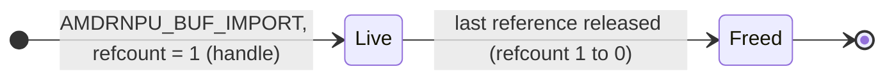
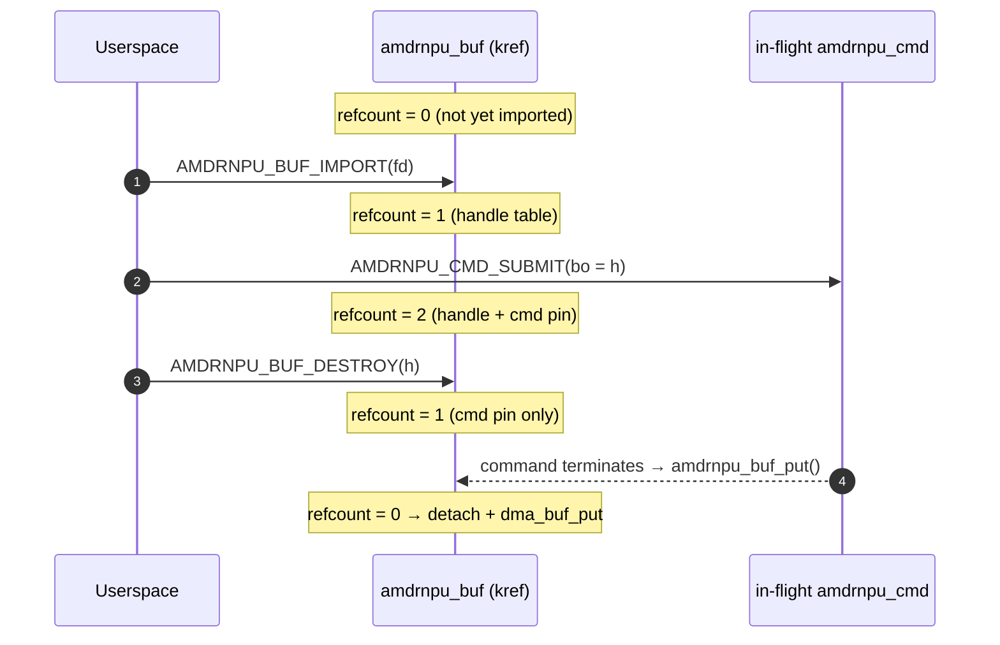
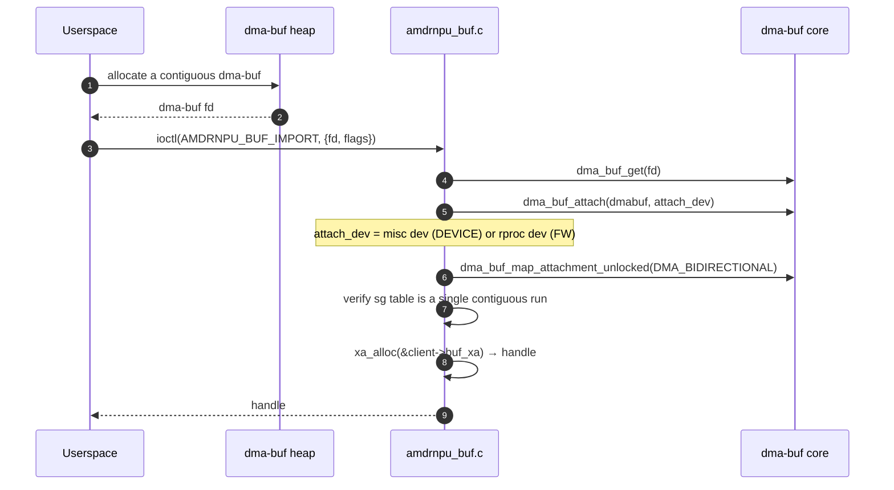

# Buffer Management

This document describes how userspace provides, references, and releases
buffers through the `amdrnpu` driver.

The driver does **not allocate buffer memory**. Userspace allocates a
dma-buf — typically from a dma-buf heap such as
`/dev/dma_heap/reserved` — and **imports** it into the driver with
**`AMDRNPU_BUF_IMPORT`**. The driver attaches the dma-buf to a DMA
domain, verifies it is physically contiguous, records its DMA address,
and returns an opaque per-file **handle**. That handle is what a
`struct amdrnpu_arg` buffer slice refers to; the driver programs
`dma_addr + offset` on the wire when the buffer is used by a command.

CPU mapping and cache maintenance are performed by userspace **on the
dma-buf fd directly** (`mmap(2)`, `DMA_BUF_IOCTL_SYNC`) — not through
this driver. The library wraps this in `amdrnpu_buf_mmap()` /
`amdrnpu_buf_sync()`.

**Userspace helpers:** [`lib-userspace-flow.md`](lib-userspace-flow.md)
covers **`amdrnpu_buf_alloc()`** (heap allocate + import in one step),
**`amdrnpu_buf_close()`**, **`amdrnpu_buf_mmap()`**, and
**`amdrnpu_buf_sync()`**, and how they line up with the ioctl flow
below.

Each imported buffer is **reference-counted** (`struct amdrnpu_buf`,
`kref`). The per-client handle table owns one reference; each in-flight
command that references the buffer holds another. The dma-buf attachment
is torn down only when the last reference is dropped — **not**
necessarily when the handle is destroyed.

---

## 1. Lifecycle overview

An imported buffer is **`Live`** from `AMDRNPU_BUF_IMPORT` until its
last reference is released. `AMDRNPU_BUF_DESTROY` (or file close) drops
the handle-table reference; if a command still pins the buffer, the
attachment survives until that command completes.



| Holder | Acquired by | Released by |
|---|---|---|
| Handle-table entry | `AMDRNPU_BUF_IMPORT` (one ref) | **`AMDRNPU_BUF_DESTROY`** / **`amdrnpu_buf_close()`**, or implicit teardown on `close()` of the device fd |
| In-flight command pin | `AMDRNPU_CMD_SUBMIT` with a buffer arg (`size != 0`) | Terminal `AMDRNPU_RSP_*`, submit-failure cleanup, or drain on channel unbind / module unload (see §4) |



---

## 2. Import: `AMDRNPU_BUF_IMPORT`



**Inputs (`struct amdrnpu_buf_import`):**

| Field | Meaning |
|-------|---------|
| `fd` | dma-buf fd to import (must be ≥ 0) |
| `flags` | target DMA domain: `AMDRNPU_BUF_IMPORT_DEVICE` (0, default) or `AMDRNPU_BUF_IMPORT_FW` (`1<<0`); all other bits reserved |
| `handle` | **output**: opaque per-file handle for `amdrnpu_arg.bo.buffer_handle` |
| `pad` | reserved, must be 0 |

The imported buffer **must be physically contiguous** — the driver
walks the mapped scatter-gather table and requires a single continuous
DMA run (`amdrnpu_sgt_dma_contig()`); otherwise import fails with
`-EINVAL`. This lets the driver hand the RPU a single base address.

**Domain selection.** `AMDRNPU_BUF_IMPORT_FW` attaches the buffer to the
remoteproc device so the emitted DMA address is the one the RPU
dereferences; it fails with `-ENODEV` on non-DT platforms where no
remoteproc device was found. `AMDRNPU_BUF_IMPORT_DEVICE` (the default)
attaches to the accelerator misc device.

**Failure modes:** `-EFAULT`, `-EINVAL` (bad flags/pad/handle, or
non-contiguous), `-ENODEV` (FW domain unavailable), `-ENOMEM`, plus any
error from `dma_buf_get` / `dma_buf_attach` /
`dma_buf_map_attachment`.

---

## 3. CPU mapping and cache sync (on the dma-buf, not the driver)

The driver imports buffers for **device DMA only**. Everything the CPU
does with the buffer — mapping it, and cache maintenance around device
DMA — happens on the **dma-buf fd** using standard kernel interfaces:

- **`mmap(2)`** on the dma-buf fd gives a CPU mapping.
- **`DMA_BUF_IOCTL_SYNC`** with `DMA_BUF_SYNC_START` /
  `DMA_BUF_SYNC_END` (and the `TO_DEVICE` / `FROM_DEVICE` direction
  bits) performs cache maintenance.

The library wraps these:

| Library helper | Underlying operation |
|----------------|----------------------|
| **`amdrnpu_buf_mmap()`** / **`amdrnpu_buf_munmap()`** | `mmap`/`munmap` on the dma-buf fd (`PROT_READ\|PROT_WRITE`, `MAP_SHARED`) |
| **`amdrnpu_buf_sync()`** and the **`_to_device()`** / **`_from_device()`** inline helpers | `DMA_BUF_IOCTL_SYNC` on the dma-buf fd |

> Note: `amdrnpu_buf_sync()`'s `offset`/`length` parameters are reserved
> — `DMA_BUF_IOCTL_SYNC` operates on the whole buffer — and
> `amdrnpu_buf_mmap()`'s `buf_size` parameter is reserved (the library
> tracks the allocation size internally). See the header for details.

Typical flow around a command that DMAs a userspace-filled input buffer:

1. CPU writes via the dma-buf mapping.
2. **`amdrnpu_buf_sync_to_device()`** (flush) before submit.
3. **`AMDRNPU_CMD_SUBMIT`** referencing the handle.
4. After completion, **`amdrnpu_buf_sync_from_device()`** (invalidate)
   before the CPU reads output.

---

## 4. In-flight command pins

A buffer referenced by a command argument (any `amdrnpu_arg` with
`size != 0`) is pinned by the driver for the command's lifetime.

```mermaid
sequenceDiagram
    autonumber
    participant U as Userspace
    participant SUB as AMDRNPU_CMD_SUBMIT
    participant CMD as amdrnpu_cmd
    participant BUF as amdrnpu_buf
    participant RPU as RPU firmware

    U->>SUB: ioctl(AMDRNPU_CMD_SUBMIT) with buffer arg (handle h)
    SUB->>BUF: amdrnpu_buf_get(client, h) → extra ref
    SUB->>BUF: bounds-check [offset, offset+size)
    SUB->>CMD: transfer ref into cmd->bo_refs[]
    SUB-->>U: sync_handle

    Note over U,BUF: BUF_DESTROY may run after submit returns; the pin keeps the buffer alive
    U->>BUF: AMDRNPU_BUF_DESTROY(h)
    Note over BUF: handle-table ref dropped; attachment survives via cmd pin

    RPU-->>CMD: terminal response over rpmsg
    CMD->>BUF: amdrnpu_buf_put() for each bo_ref
```

**At termination** the driver puts each `bo_refs[]` entry once. This
covers normal completions, error-class responses, submit-failure
cleanup, channel-unbind drain (`-ENOTCONN`), and module unload
(`-ENODEV`).

**Userspace:** after a successful submit you may call
**`AMDRNPU_BUF_DESTROY`** / **`amdrnpu_buf_close()`** as soon as you no
longer need the handle for your own lookups; the buffer stays attached
until the command finishes and drops its pin.

---

## 5. Release / cleanup

An imported buffer is torn down when its refcount reaches **0**. Paths:

- **`AMDRNPU_BUF_DESTROY`** / **`amdrnpu_buf_close()`** on the handle
  (`xa_erase` + `amdrnpu_buf_put`).
- **`close(fd)`** on the device node walks the client's `buf_xa` and
  releases every remaining handle
  (`amdrnpu_client_buf_release()`).
- The final **command completion** dropping the last `bo_refs[]` pin.

When the last reference goes away, `amdrnpu_buf_release()` runs:

```c
dma_buf_unmap_attachment_unlocked(buf->attach, buf->sgt, DMA_BIDIRECTIONAL);
dma_buf_detach(buf->dmabuf, buf->attach);
dma_buf_put(buf->dmabuf);
```

While a command still pins a buffer, `AMDRNPU_BUF_DESTROY` only drops
the handle-table reference — the attachment (and the underlying dma-buf)
survive until the submit completes.

---

## 6. Userspace sketch

Using the library, which allocates from the correct dma-buf heap and
imports in one step:

```c
#include <errno.h>
#include <string.h>
#include <unistd.h>
#include <amdrnpu/amdrnpu_lib.h>

int main(void)
{
	int fd = open("/dev/amdrnpu.0", O_RDWR | O_CLOEXEC);
	uint32_t handle;
	uint64_t sz = 1u << 20;
	void *p;

	if (fd < 0)
		return 1;
	if (amdrnpu_buf_alloc(fd, AMDRNPU_MEMORY_DEVICE, sz, &handle))
		return 1;

	amdrnpu_buf_mmap(fd, handle, 0, 0, 0, &p);	/* whole buffer */
	memset(p, 0xa5, sz);
	amdrnpu_buf_sync_to_device(fd, handle, 0, 0);
	/* ... AMDRNPU_CMD_SUBMIT referencing handle ... */
	amdrnpu_buf_munmap(p, sz);
	amdrnpu_buf_close(fd, handle);
	close(fd);
	return 0;
}
```

A raw ioctl caller would instead allocate its own dma-buf (e.g. via a
dma-buf heap), call `AMDRNPU_BUF_IMPORT` with the fd, `mmap`/
`DMA_BUF_IOCTL_SYNC` on that dma-buf fd, and `AMDRNPU_BUF_DESTROY` when
done.

---

## 7. See also

- [`architecture.md`](architecture.md) — the two DMA domains and how the
  driver imports dma-bufs.
- [`commands.md`](commands.md) — `amdrnpu_arg` buffer references and how
  they become wire DMA addresses.
- [`lib-userspace-flow.md`](lib-userspace-flow.md) — the library API for
  allocate, import, map, sync, and release.
