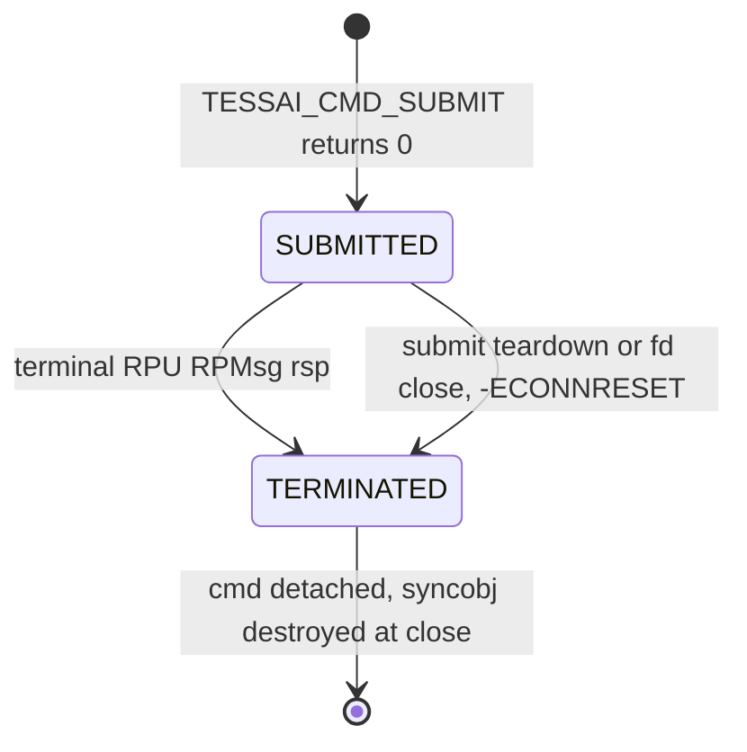
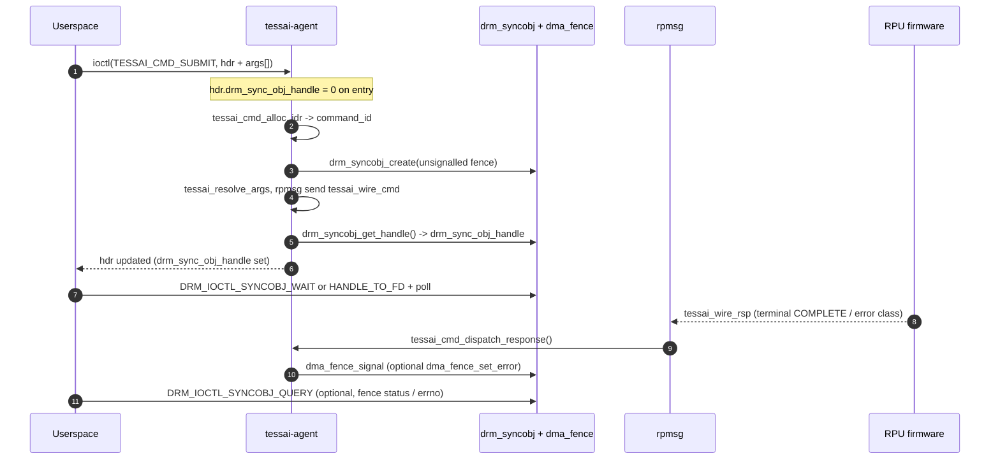

# Command Submission and Termination

This document describes how userspace drives the RPU through the
`tessai-agent` driver: `TESSAI_CMD_SUBMIT`, the returned `drm_syncobj`
with a single `dma_fence`, and termination. There is **no** dedicated `TESSAI_CMD_CANCEL`
ioctl; commands end on a terminal RPU response, submit failure cleanup, or
`drm_file` close.

The model is minimal:

- **Two states only.** `SUBMITTED` (after `TESSAI_CMD_SUBMIT` returns 0) and
  `TERMINATED` (after `TESSAI_RSP_COMPLETE` / `TESSAI_RSP_*` failure from the RPU,
  failed submit cleanup, or process `close()` on the DRM fd). There is
  no separate `INIT` / `PENDING` exposed to userspace.
- **Identity.** Userspace identifies the in-flight work through the
  **`drm_sync_obj_handle`** returned in `struct tessai_cmd_submit` (same object used
  for waits). The kernel still allocates an internal `command_id`
  (wire id) that userspace does not need to store.
- **No driver-specific wait ioctl.** Use `DRM_IOCTL_SYNCOBJ_WAIT`,
  `DRM_IOCTL_SYNCOBJ_HANDLE_TO_FD` + `poll()`, and
  **`DRM_IOCTL_SYNCOBJ_QUERY`** to read signaled state and fence errno
  after a wakeup (or call the wrappers in **`tessai_agent_lib`** — see [lib-userspace-flow.md](lib-userspace-flow.md)).

---

## 1. State machine

In `TERMINATED`, the syncobj’s last fence stays signalled;
`dma_fence_set_error()` carries `-EREMOTEIO` / `-ECONNRESET` (and other
driver errors) through `DRM_IOCTL_SYNCOBJ_WAIT` as appropriate.

---

## 2. End-to-end flow

---

## 3. Wire format

### `tessai_arg` → wire word

| Argument | Encoding in `args[i]` (little-endian QWORD) |
|----------|-----------------------------------------------|
| Scalar   | `size == 0`: wire word = `value` |
| Buffer   | `size > 0`: `lookup(bo.drm_buffer_handle)`, validate `[offset, offset+size)`, wire word = `dma_addr + offset` |

### `command_rsp_type` (matches `enum tessai_rsp_type` in `tessai_agent_cmd.h`)

| Value | Name | Fence / command |
|------:|------|-----------------|
| 0 | `TESSAI_RSP_COMPLETE` | Success; fence signalled |
| 1 | `TESSAI_RSP_REMOTEIO` | Terminate; fence error `-EREMOTEIO` |
| 2 | `TESSAI_RSP_NOTSUPPORTED` | Terminate; fence error `-EOPNOTSUPP` |
| 3 | `TESSAI_RSP_CANCELLED` | Terminate; fence error `-ECANCELED` |
| *other* | — | **Invalid:** driver logs and completes the slot with fence error `-EREMOTEIO` (same effect as an explicit remote fault, not ignored). |

There is **no** in-driver progress /
multi-stage fence for a single submission; firmware should use DMA or a
buffer-based side protocol if it needs to stream milestones while the command
slot stays occupied.

`TESSAI_RSP_ERROR` in legacy code is **`#define`d** to **`TESSAI_RSP_REMOTEIO`**
in [`tessai_agent_cmd.h`](../drivers/misc/tessai-agent/tessai_agent_cmd.h).

---

## 4. `TESSAI_CMD_SUBMIT`

Variable-length ioctl payload: in-kernel/driver code uses an internal
`struct tessai_submit_cmd` mirror; the **UAPI** type is `struct tessai_cmd_submit`
— fixed header through `offsetof(struct tessai_cmd_submit, args)` plus
`num_args × sizeof(struct tessai_arg)`.

| Field | Direction | Meaning |
|-------|-----------|---------|
| `drm_sync_obj_handle` | in/out | **In:** `0` for a new command. **Out:** DRM syncobj handle (binary) for waits. |
| `command_op` | in | Firmware opcode selector |
| `num_args` | in | Number of trailing `tessai_arg`; ≤ `TESSAI_MAX_ARGS` |
| `args[]` | in | Scalar and buffer GEM slices |

Failure modes include `-EFAULT`, `-EINVAL`, `-E2BIG`, `-ENOMEM`,
`-ENOENT` (bad BO handle), `-ENOTCONN` (no rpmsg channel).

If submission fails **after** the RPU has been sent a `tessai_wire_cmd` but
**before** userspace receives the syncobj handle (or if copying the
result header fails), the driver may send a best-effort abort
(`flags = 0x80000001` on the wire) so firmware can drop the work.

---

## 5. Waiting and querying (DRM only)

Equivalent ways to block or poll:

- **`DRM_IOCTL_SYNCOBJ_WAIT`** — waits on handles using an absolute
  **`CLOCK_MONOTONIC`** deadline (`timeout_nsec` / `deadline_nsec` per your
  kernel UAPI); **`tessai_agent_syncobj_wait_complete()`** uses it internally
  when given a positive relative **`timeout_ns`** (lib converts to an absolute
  deadline).
- **`DRM_IOCTL_SYNCOBJ_HANDLE_TO_FD`** with **`DRM_SYNCOBJ_HANDLE_TO_FD_FLAGS_EXPORT_SYNC_FILE`**
  + `poll()` / `epoll` on the **sync_file** (see **`tessai_agent_syncobj_to_fence_fd()`**).
- **`DRM_IOCTL_SYNCOBJ_QUERY`** — read **signaled** state and the backing
  **`dma_fence`** status (`errno`/completion reason) when available on your DRM.
- **`tessai_agent_syncobj_fence_status()`** — portable probe via **`SYNC_IOC_FILE_INFO`**
  on an exported sync_file (implemented in `libtessai_agent`); **non-blocking**.
- **`tessai_agent_syncobj_wait_busy_poll()`** — application-level polling loop:
  repeats `fence_status` with **`nanosleep(interval_ns)`** between probes (**sleeping poll**),
  or **`sched_yield()`** only when `interval_ns == 0` (**tight cooperative poll** — not hardware busy-spin).

There is **no** vendor `TESSAI_GET_LAST_EVENT` ioctl; introspection goes
through the syncobj/fence path above. End-to-end C flows are spelled out in
[`lib-userspace-flow.md`](lib-userspace-flow.md).

---

## 6. Single dma_fence per submission

Each command allocates **one** unsignaled `dma_fence` at submit time,
wraps it in the returned syncobj, and keeps that pairing until **one**
terminal RPMsg response (or IOCTL/teardown failures that complete the slot
without a response). Nothing calls `drm_syncobj_replace_fence()`: there is no
fence “rotation”. Reference-count semantics follow the usual DRM syncobj
helpers in `drm_syncobj.c`.

---

## 7. Userspace sketch

Prefer **`tessai_agent_cmd_submit()`** + **`tessai_agent_syncobj_wait_complete()`**
(or **`tessai_agent_syncobj_wait_busy_poll()`** for a polling loop) from
[`lib/tessai-agent/include/tessai_agent/tessai_agent_lib.h`](../lib/tessai-agent/include/tessai_agent/tessai_agent_lib.h).
Release GEMs with **`tessai_agent_gem_close()`** when appropriate (see
[`buffer-management.md`](buffer-management.md)).

Raw ioctl callers must allocate a contiguous blob:
`offsetof(struct tessai_cmd_submit, args) + num_args*sizeof(struct tessai_arg)`,
clear **`drm_sync_obj_handle`** on entry, and pass **`TESSAI_CMD_SUBMIT`**. For SYNCOBJ
timeouts, populate absolute monotonic **`timeout_nsec`** (see kernel
`drm_syncobj_wait`/your header); **`-1` is not a portable “infinity” sentinel**
on newer DRM — use **`INT64_MAX`** as the relative nanoseconds argument to
**`tessai_agent_syncobj_wait_complete()`**, use an unbounded
**`tessai_agent_syncobj_wait_busy_poll()`** (`max_wall_ns < 0`), or pass **`NULL`**
only when driving **`DRM_IOCTL_SYNCOBJ_WAIT`** yourself.

See **`docs/lib-userspace-flow.md`** for sequence diagrams tying buffers and
commands together.

Use `libdrm` helpers (`drmSyncobjWait`, `drmSyncobjQuery`, …) instead of
raw ioctls if convenient.

---

## 8. See also

- [`architecture.md`](architecture.md) — driver blocks and rpmsg bind.
- [`buffer-management.md`](buffer-management.md) — GEM allocation,
  buffer-style `tessai_arg` pinning, and buffer lifetime.
