# Command Submission and Completion

This document describes how userspace drives the RPU through the
`amdrnpu` driver: **`AMDRNPU_CMD_SUBMIT`**, the returned **`sync_file`**
fd backed by a per-command **`dma_fence`**, and completion. There is
**no** `AMDRNPU_CMD_CANCEL` ioctl; commands end on a terminal RPU
response, submit-failure cleanup, or channel unbind / module unload.

The model is minimal but **fully asynchronous with many commands in
flight**:

- **Two observable states.** `SUBMITTED` (after `AMDRNPU_CMD_SUBMIT`
  returns 0) and `TERMINATED` (after a terminal `AMDRNPU_RSP_*` response
  from the RPU, submit-failure cleanup, or forced drain). There is no
  separate `INIT` / `PENDING` state exposed to userspace.
- **Identity.** Userspace identifies work only through the
  **`sync_handle`** returned in `struct amdrnpu_cmd_submit` — a
  `sync_file` fd it owns. **Wire command ids are allocated and managed
  solely by the driver** via `xa_alloc_cyclic()` on `cmd_xa` (ids
  `0..UINT_MAX` via `xa_limit_32b`, reused when free). Userspace never
  chooses or stores the id. On rpmsg the id is sent as
  `amdrnpu_wire_cmd.seq` and echoed in `amdrnpu_wire_rsp.seq`. Responses
  may arrive out of submit order; matching is always by that id.
- **Wait via the fence fd.** `poll(2)` the `sync_handle` for `POLLIN`,
  or use the `amdrnpu_syncobj_*` wrappers in **`libamdrnpu`** (see
  [lib-userspace-flow.md](lib-userspace-flow.md)). Read the fence error
  via `SYNC_IOC_FILE_INFO`.

---

## 1. State machine

```mermaid
stateDiagram-v2
    [*] --> SUBMITTED : AMDRNPU_CMD_SUBMIT returns 0
    SUBMITTED --> TERMINATED : terminal RPU rpmsg response
    SUBMITTED --> TERMINATED : submit teardown, or channel unbind / unload
    TERMINATED --> [*] : fence signalled; sync_file fd closed by userspace
```



On termination the `dma_fence` is signalled. Error classes carry through
`dma_fence_set_error()`: `-EREMOTEIO` / `-EOPNOTSUPP` / `-ECANCELED`
from RPU responses, `-ENOTCONN` on channel unbind, `-ENODEV` on module
unload, `-ECONNRESET` from the command-release fallback, or the submit
errno on ioctl-path failures.

---

## 2. End-to-end flow

```mermaid
sequenceDiagram
    autonumber
    participant U as Userspace
    participant K as amdrnpu
    participant F as dma_fence + sync_file
    participant RPMSG as rpmsg
    participant RPU as RPU firmware

    U->>K: ioctl(AMDRNPU_CMD_SUBMIT, hdr + args[])
    Note over K: hdr.sync_handle = 0 on entry
    K->>K: amdrnpu_cmd_create; xa_alloc_cyclic id (seq)
    K->>F: create unsignalled dma_fence
    K->>K: amdrnpu_resolve_args (buffer handles → DMA addrs)
    K->>RPMSG: rpmsg_send(amdrnpu_wire_cmd, seq)
    K->>F: sync_file_create(fence) → fd
    K-->>U: hdr.sync_handle = fd

    U->>F: poll(fd, POLLIN)  (or amdrnpu_syncobj_wait_complete)

    RPU-->>RPMSG: amdrnpu_wire_rsp (seq, command_rsp_type)
    RPMSG->>K: amdrnpu_dev_cmd_dispatch_response()
    K->>K: cmd = xa_erase(cmd_xa, seq)
    K->>F: dma_fence_signal (+ set_error on fault)
    U->>F: SYNC_IOC_FILE_INFO (fence status / errno)
    U->>F: close(fd)
```

---

## 3. Wire format

Wire layouts are defined in
[`amdrnpu_cmd.h`](../drivers/rpmsg/amdrnpu/amdrnpu_cmd.h)
(driver-internal, not UAPI).

### Host → RPU (`amdrnpu_wire_cmd`, `__packed`)

| Field | Type | Meaning |
|-------|------|---------|
| `seq` | `__le32` | Driver-assigned command id (`xa_alloc_cyclic`, `0..UINT_MAX`, reused when free); firmware echoes it on response |
| `command_op` | `__le32` | Firmware opcode (same as ioctl `command_op`) |
| `flags` | `__le32` | Reserved (submit uses `0`) |
| `num_args` | `__le32` | Count of trailing `args[]` QWORDs |
| `args[]` | `__le64[]` | Resolved scalar values / buffer DMA addresses |

The total message must fit in one rpmsg buffer; the driver rejects a
command whose wire size exceeds 4096 bytes with `-E2BIG`.

### RPU → host (`amdrnpu_wire_rsp`, `__packed`)

| Field | Type | Meaning |
|-------|------|---------|
| `seq` | `__le32` | Echo of the driver-assigned command id |
| `command_rsp_type` | `__le32` | Terminal status (`enum amdrnpu_rsp_type`) |

### `amdrnpu_arg` → wire word

| Argument | Encoding in `args[i]` (little-endian QWORD) |
|----------|-----------------------------------------------|
| Scalar   | `size == 0`: wire word = `value` |
| Buffer   | `size != 0`: look up `bo.buffer_handle`, validate `[offset, offset+size)` within the buffer, wire word = `dma_addr + bo.offset` |

### `command_rsp_type` (matches `enum amdrnpu_rsp_type`)

| Value | Name | Fence result |
|------:|------|-----------------|
| 0 | `AMDRNPU_RSP_COMPLETE` | Success; fence signalled, no error |
| 1 | `AMDRNPU_RSP_REMOTEIO` | Fence error `-EREMOTEIO` |
| 2 | `AMDRNPU_RSP_NOTSUPPORTED` | Fence error `-EOPNOTSUPP` |
| 3 | `AMDRNPU_RSP_CANCELLED` | Fence error `-ECANCELED` |
| *other* | — | **Fault:** driver logs and completes the command with fence error `-EREMOTEIO` (via `amdrnpu_rsp_err()`) |

There is **no** in-driver progress / multi-stage fence: a single
submission owns exactly one `dma_fence` from submit to its single
terminal response. Firmware that needs to stream milestones must do so
through a buffer-based side protocol.

---

## 4. `AMDRNPU_CMD_SUBMIT`

Variable-length ioctl payload: the **UAPI** type is
`struct amdrnpu_cmd_submit` — the fixed header through
`offsetof(struct amdrnpu_cmd_submit, args)` plus
`num_args × sizeof(struct amdrnpu_arg)`.

| Field | Direction | Meaning |
|-------|-----------|---------|
| `sync_handle` | in/out | **In:** must be `0`. **Out:** a `sync_file` fd for this submission. |
| `command_op` | in | Firmware opcode selector |
| `num_args` | in | Number of trailing `amdrnpu_arg`; ≤ `AMDRNPU_MAX_ARGS` (64) |
| `args[]` | in | Scalar values and buffer slices |

### Example: `OP_CODE_CMD0` with input/output buffers

Firmware opcodes and scalar tags are defined by the RPU image; the
pattern below matches a common six-argument layout (tag + size + buffer
slice per direction). `bo0_hd` / `bo1_hd` are handles from
`AMDRNPU_BUF_ALLOC` (or `AMDRNPU_BUF_IMPORT`) on the same device fd.

```c
#define OP_CODE_CMD0  0x00000001u
#define INPUT_BO      1ull
#define OUTPUT_BO     2ull
#define SZ_16M        (16u * 1024u * 1024u)
#define SZ_8M         (8u * 1024u * 1024u)

struct amdrnpu_arg args[6];

args[0] = (struct amdrnpu_arg){ .size = 0, .value = INPUT_BO };
args[1] = (struct amdrnpu_arg){ .size = 0, .value = SZ_16M };
args[2] = (struct amdrnpu_arg){
	.size = SZ_16M,
	.bo = { .buffer_handle = (__s32)bo0_hd, .offset = 0 },
};
args[3] = (struct amdrnpu_arg){ .size = 0, .value = OUTPUT_BO };
args[4] = (struct amdrnpu_arg){ .size = 0, .value = SZ_8M };
args[5] = (struct amdrnpu_arg){
	.size = SZ_8M,
	.bo = { .buffer_handle = (__s32)bo1_hd, .offset = 0 },
};

struct amdrnpu_cmd_submit hdr = {
	.sync_handle = 0,
	.command_op = OP_CODE_CMD0,
	.num_args = 6,
};
/* Raw ioctl: pass a buffer of offsetof(..., args) + 6*sizeof(struct amdrnpu_arg);
 * or amdrnpu_cmd_submit(fd, OP_CODE_CMD0, args, 6, &hdr, sizeof(hdr)). */
```

| Index | `size` | Payload | Role |
|------:|--------|---------|------|
| 0 | 0 | `INPUT_BO` | Firmware input-buffer tag (scalar) |
| 1 | 0 | `SZ_16M` | Input size (scalar) |
| 2 | `SZ_16M` | `bo0_hd` @ offset 0 | Input buffer slice → wire DMA address |
| 3 | 0 | `OUTPUT_BO` | Firmware output-buffer tag (scalar) |
| 4 | 0 | `SZ_8M` | Output size (scalar) |
| 5 | `SZ_8M` | `bo1_hd` @ offset 0 | Output buffer slice → wire DMA address |

Failure modes include `-EFAULT`, `-EINVAL` (non-zero `sync_handle` on
entry, or a buffer arg with an invalid/out-of-bounds handle),
`-E2BIG` (too many args or oversized wire message), `-ENOMEM`,
`-ENOENT` (unknown buffer handle), and `-ENOTCONN` (no rpmsg channel).

If submission fails **after** the RPU has been sent the wire command but
**before** userspace receives the fd (or if copying the result header
fails), the driver removes the command from `cmd_xa` if it still owns
it, signals the fence with the ioctl errno, and drops the command.

---

## 5. Waiting and querying

The `sync_handle` is a `sync_file` fd, so any of these work:

- **`poll(2)` / `epoll`** on the fd for `POLLIN` — signals when the
  fence completes (including completion with an error). Read the fence
  error afterwards.
- **`amdrnpu_syncobj_wait_complete()`** — relative-timeout wait
  (`timeout_ns == 0` probes; `> 0` waits; `< 0` is rejected). Writes
  `0` (pending), `1` (completed OK), or a negative fence errno.
- **`amdrnpu_syncobj_fence_status()`** — non-blocking probe via
  `SYNC_IOC_FILE_INFO` (`>0` signalled, `0` pending, `<0` errno).
- **`amdrnpu_syncobj_to_fence_fd()`** — a `dup`'d (`F_DUPFD_CLOEXEC`)
  fence fd for an independent blocking `poll(2)`.

> `amdrnpu_syncobj_wait_busy_poll()` is **obsolete**: there is no way to
> query command status ahead of the response message, so it simply
> delegates to `amdrnpu_syncobj_wait_complete()`.

Unlike the old DRM implementation, none of these helpers destroy the
handle — userspace owns the `sync_file` fd and must `close(2)` it. End-
to-end C flows are spelled out in
[`lib-userspace-flow.md`](lib-userspace-flow.md).

---

## 6. One dma_fence per submission

Each command allocates **one** unsignalled `dma_fence` at submit time
(`amdrnpu_fence_create()`, on the device's `fence_context`), wraps it in
the returned `sync_file`, and keeps that pairing until **one** terminal
event completes it. Nothing rotates or replaces the fence.

Completion is race-safe: whoever removes the command from `cmd_xa` (the
response dispatcher, the submit-failure path, or a drain) owns signalling
the fence and dropping the `cmd_xa` reference. The `dma_fence` is
independently reference-counted (exported via the `sync_file`), so it
can outlive the command object.

---

## 7. Userspace sketch

Prefer **`amdrnpu_cmd_submit()`** + **`amdrnpu_syncobj_wait_complete()`**
from
[`lib/include/amdrnpu/amdrnpu_lib.h`](../lib/include/amdrnpu/amdrnpu_lib.h),
and release buffers with **`amdrnpu_buf_close()`** when appropriate (see
[`buffer-management.md`](buffer-management.md)).

```c
struct amdrnpu_cmd_submit hdr;
int32_t st = 0;

if (amdrnpu_cmd_submit(fd, OP_CODE_CMD0, args, 6, &hdr, sizeof(hdr)))
	/* handle error */;

/* Bounded wait; INT64_MAX for effectively unbounded. */
amdrnpu_syncobj_wait_complete(fd, (uint32_t)hdr.sync_handle,
			      2000000000ll, &st);
/* st: 0 pending, 1 ok, <0 fence errno */
close(hdr.sync_handle);
```

Raw ioctl callers must allocate a contiguous blob of
`offsetof(struct amdrnpu_cmd_submit, args) + num_args*sizeof(struct amdrnpu_arg)`,
clear `sync_handle` on entry, issue `AMDRNPU_CMD_SUBMIT`, then
`poll(2)` the returned fd for `POLLIN` and `close(2)` it.

---

## 8. See also

- [`architecture.md`](architecture.md) — driver blocks and rpmsg bind.
- [`buffer-management.md`](buffer-management.md) — `amdrnpu_arg` buffer
  references and in-flight command pins.
