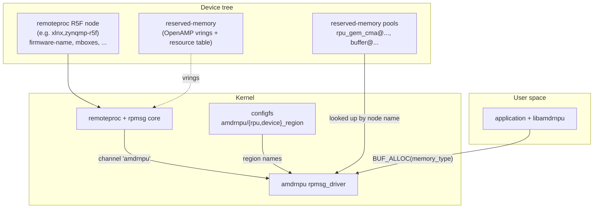

# Platform integration (device tree & reserved memory)

**`amdrnpu` has no device-tree binding of its own.** It is a pure rpmsg
client: the module registers one `rpmsg_driver` whose `id_table` matches
the channel name **`amdrnpu`**, and a `/dev/amdrnpu.N` node is created
whenever RPU firmware advertises that channel (see
[`architecture.md` §3](architecture.md#3-instances-and-rpmsg-binding)).

There is therefore **no** `amd,amdrnpu` compatible, **no** `bank@0` /
`bank@1` child nodes, and **no** binding schema under
`Documentation/devicetree/bindings/`. This page instead documents the
platform infrastructure the driver *depends on*:

1. the **remoteproc** (R5F) node and its firmware, which brings up the
   rpmsg channel;
2. the **OpenAMP reserved-memory** used by the rpmsg transport; and
3. the **reserved-memory regions** the driver allocates command buffers
   from (`AMDRNPU_BUF_ALLOC`). The driver finds these by node name; it
   does not need any properties or nodes of its own added to the DT.

---

## 1. At a glance



The driver walks up from the bound rpmsg channel to the first ancestor
device with a DT node — that is the **remoteproc device** — and uses its
DMA configuration for firmware-visible buffers (`AMDRNPU_MEMORY_RPU`
allocations and `AMDRNPU_BUF_IMPORT_FW` imports). Physical placement of
an allocated buffer comes from the region configured for its memory
type (§4).

---

## 2. Remoteproc node and firmware

`amdrnpu` does not probe the remoteproc node directly; it relies on the
platform's remoteproc driver (for example Xilinx `xlnx,zynqmp-r5f`) to
load and boot the R5F firmware. When that firmware runs its OpenAMP
stack and announces an rpmsg channel named **`amdrnpu`**, the rpmsg core
probes this driver and a `/dev/amdrnpu.N` node appears.

Requirements:

- A remoteproc node whose firmware advertises the **`amdrnpu`** rpmsg
  channel (`amdrnpu_ept.c` in the RPU firmware).
- The remoteproc node must have an `of_node` (it does, being a DT
  device) so the driver can resolve the firmware DMA domain by walking
  the rpmsg parent chain. On non-DT platforms, `AMDRNPU_MEMORY_RPU`
  allocations and `AMDRNPU_BUF_IMPORT_FW` imports fail with `-ENODEV`.

Multiple R5Fs each advertising the channel produce multiple
`/dev/amdrnpu.N` nodes, indexed in bind order by a module-global
counter.

---

## 3. OpenAMP reserved-memory

The rpmsg transport (vrings, virtio buffer pool, resource table) uses
reserved-memory regions described in device tree and shared with the
RPU. These belong to the **remoteproc / OpenAMP** setup, not to
`amdrnpu`; the driver never touches them directly. A representative
layout (matching `lib/examples/README-inout-example.md`):

| Region | Physical start | Size |
|--------|----------------|------|
| Resource table | `0x09800000` | 256 B |
| VirtIO vring 0 | `0x09860000` | 16 KiB |
| VirtIO vring 1 | `0x09864000` | 16 KiB |
| VirtIO buffer pool | `0x09868000` | 256 KiB |

These addresses must match the RPU firmware's OpenAMP overlay.

---

## 4. Command buffers come from reserved-memory regions

`AMDRNPU_BUF_ALLOC` (and so the library's `amdrnpu_buf_alloc()`)
allocates each buffer from one `shared-dma-pool` node under
`/reserved-memory`, chosen by memory type:

| `memory_type` | configfs attribute | Default node name | DMA domain |
|---|---|---|---|
| `AMDRNPU_MEMORY_RPU` | `/sys/kernel/config/amdrnpu/rpu_region` | `rpu_gem_cma` | remoteproc device's DMA configuration, 32-bit mask |
| `AMDRNPU_MEMORY_DEVICE` | `/sys/kernel/config/amdrnpu/device_region` | `buffer` | 64-bit mask |

The lookup is by **node name**, not label or phandle, so no DT changes
are needed. A name without a unit address matches any unit address
(`rpu_gem_cma` matches `rpu_gem_cma@20000000`); if more than one node
matches, write the full name (`name@address`). A region is bound on the
first allocation of its type, and its attribute returns `-EBUSY` on
write from then until the device is released.

Requirements on each region:

- `compatible = "shared-dma-pool"`, either `reusable` (CMA) or `no-map`.
  Allocations are physically contiguous in both cases.
- For the RPU region: below 4 GiB, and inside the span the RPU
  firmware's MPU/MMU maps, so the RPU can dereference the address it is
  given.
- Don't point a region at memory something else owns exclusively, such
  as the firmware's own carveouts.

For example, the VEK385 layout these defaults match:

```dts
reserved-memory {
    #address-cells = <2>;
    #size-cells = <2>;
    ranges;

    /* AMDRNPU_MEMORY_RPU: RPU-reachable pool below 4 GiB. */
    rpu_gem_cma@20000000 {
        compatible = "shared-dma-pool";
        reusable;
        reg = <0x0 0x20000000 0x0 0x20000000>; /* 512 MiB */
    };

    /* AMDRNPU_MEMORY_DEVICE: high-DDR pool. */
    buffer@50000000000 {
        compatible = "shared-dma-pool";
        reusable;
        linux,cma-default;
        reg = <0x500 0x00000000 0x2 0x00000000>; /* 8 GiB */
    };
};
```

Buffers brought in with `AMDRNPU_BUF_IMPORT` don't use these regions;
their exporter decides placement. An imported buffer must be
**physically contiguous** (the driver rejects a scattered SG table) and,
for firmware use (`AMDRNPU_BUF_IMPORT_FW`), **RPU-reachable**.

---

## 5. Common pitfalls

- **`AMDRNPU_BUF_ALLOC` fails with `-ENODEV`.** No `/reserved-memory`
  child matches the configured name, or the node is not an initialised
  `shared-dma-pool`. Check `dmesg` and the names under
  `/sys/kernel/config/amdrnpu/`. An ambiguous name fails with `-EINVAL`;
  use the full `name@address`.
- **Can't change the region (`-EBUSY`).** The region is already bound by
  an earlier allocation. Set the configfs attribute before the first
  `AMDRNPU_BUF_ALLOC` of that type.
- **RPU can't see the buffer.** If an RPU buffer comes from a pool the
  RPU firmware doesn't map, the RPU faults when it dereferences the DMA
  address. Make sure the firmware MPU covers the RPU region (or, for
  imports, the exporter's pool).
- **Non-contiguous dma-buf.** Import fails with `-EINVAL` if the mapped
  scatter-gather table is not a single contiguous run. Export from a
  pool that guarantees contiguity (CMA / carveout), not the generic
  system heap.
- **FW domain on a non-DT platform.** `AMDRNPU_MEMORY_RPU` allocations
  and `AMDRNPU_BUF_IMPORT_FW` imports return `-ENODEV` when the rpmsg
  channel has no DT-backed ancestor to use as the remoteproc DMA device.
- **Wrong / missing channel name.** The driver only binds to an rpmsg
  channel named exactly **`amdrnpu`**. Confirm the firmware's OpenAMP
  endpoint name.

---

## 6. See also

- [`architecture.md`](architecture.md) — rpmsg binding, DMA domains, and
  the miscdevice.
- [`buffer-management.md`](buffer-management.md) — buffer allocation,
  dma-buf import, contiguity, and handle lifetime.
- [`lib-userspace-flow.md`](lib-userspace-flow.md) — the library's
  `amdrnpu_buf_alloc()` and `AMDRNPU_MEMORY_*`.
