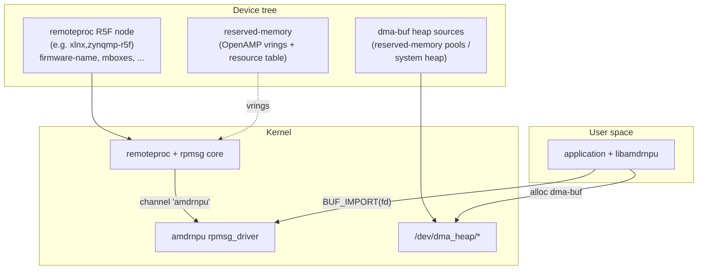

# Platform integration (device tree & dma-buf heaps)

**`amdrnpu` has no device-tree binding of its own.** It is a pure rpmsg
client: the module registers one `rpmsg_driver` whose `id_table` matches
the channel name **`amdrnpu`**, and a `/dev/amdrnpu.N` node is created
whenever RPU firmware advertises that channel (see
[`architecture.md` §3](architecture.md#3-instances-and-rpmsg-binding)).

There is therefore **no** `amd,amdrnpu` compatible, **no** `bank@0` /
`bank@1` child nodes, and **no** binding schema under
`Documentation/devicetree/bindings/`. This page instead documents the
platform infrastructure the driver *depends on*:

1. the **remoteproc** (R5F) node and its firmware, which brings up the
   rpmsg channel;
2. the **OpenAMP reserved-memory** used by the rpmsg transport; and
3. the **dma-buf heaps** userspace allocates command buffers from.

---

## 1. At a glance



The driver walks up from the bound rpmsg channel to the first ancestor
device with a DT node — that is the **remoteproc device** — and uses it
as the DMA domain for firmware-visible buffers
(`AMDRNPU_BUF_IMPORT_FW`). Everything else about placement comes from the
heap the buffer was allocated from.

---

## 2. Remoteproc node and firmware

`amdrnpu` does not probe the remoteproc node directly; it relies on the
platform's remoteproc driver (for example Xilinx `xlnx,zynqmp-r5f`) to
load and boot the R5F firmware. When that firmware runs its OpenAMP
stack and announces an rpmsg channel named **`amdrnpu`**, the rpmsg core
probes this driver and a `/dev/amdrnpu.N` node appears.

Requirements:

- A remoteproc node whose firmware advertises the **`amdrnpu`** rpmsg
  channel (`amdrnpu_ept.c` in the RPU firmware).
- The remoteproc node must have an `of_node` (it does, being a DT
  device) so the driver can resolve the firmware DMA domain by walking
  the rpmsg parent chain. On non-DT platforms, `AMDRNPU_BUF_IMPORT_FW`
  imports fail with `-ENODEV`.

Multiple R5Fs each advertising the channel produce multiple
`/dev/amdrnpu.N` nodes, indexed in bind order by a module-global
counter.

---

## 3. OpenAMP reserved-memory

The rpmsg transport (vrings, virtio buffer pool, resource table) uses
reserved-memory regions described in device tree and shared with the
RPU. These belong to the **remoteproc / OpenAMP** setup, not to
`amdrnpu`; the driver never touches them directly. A representative
layout (matching `lib/examples/README-inout-example.md`):

| Region | Physical start | Size |
|--------|----------------|------|
| Resource table | `0x09800000` | 256 B |
| VirtIO vring 0 | `0x09860000` | 16 KiB |
| VirtIO vring 1 | `0x09864000` | 16 KiB |
| VirtIO buffer pool | `0x09868000` | 256 KiB |

These addresses must match the RPU firmware's OpenAMP overlay.

---

## 4. Command buffers come from dma-buf heaps

The driver imports buffers; it never allocates them. Userspace obtains a
dma-buf from a **dma-buf heap** and imports the fd with
`AMDRNPU_BUF_IMPORT`. The imported buffer must be **physically
contiguous** (the driver rejects a scattered SG table), and to be
usable by the RPU it must live in an RPU-reachable region.

Two DMA domains exist, selected by the import `flags`:

| `flags` | Attach device | Placement source |
|---------|---------------|------------------|
| `AMDRNPU_BUF_IMPORT_DEVICE` (0) | accelerator misc device (64-bit mask) | the device-visible heap |
| `AMDRNPU_BUF_IMPORT_FW` (`1<<0`) | remoteproc device | an RPU-reachable heap |

The library's `amdrnpu_buf_alloc()` selects the matching heap and import
flag for `AMDRNPU_MEMORY_RPU` vs `AMDRNPU_MEMORY_DEVICE`.

### Reserved-memory-backed heaps

An RPU-reachable, contiguous pool is typically exposed as a dma-buf
heap. For example, a `shared-dma-pool` reserved-memory region that the
RPU firmware also maps (its MPU/MMU must cover the same physical span):

```dts
reserved-memory {
    #address-cells = <2>;
    #size-cells = <2>;
    ranges;

    /*
     * RPU-reachable contiguous pool (below 4 GiB). Exposed to userspace
     * as a dma-buf heap; buffers allocated here are imported with
     * AMDRNPU_BUF_IMPORT_FW so the RPU can dereference their DMA address.
     */
    rpu_reserved@20000000 {
        compatible = "shared-dma-pool";
        reusable;
        reg = <0x0 0x20000000 0x0 0x20000000>; /* 512 MiB */
    };
};
```

How a reserved-memory region becomes a `/dev/dma_heap/*` node is
platform-specific (e.g. a CMA heap or a dedicated reserved-memory heap
exporter). The key contract for `amdrnpu` is only that the resulting
dma-buf is **physically contiguous** and, for firmware use,
**RPU-reachable**.

---

## 5. Common pitfalls

- **RPU can't see the buffer.** If an `AMDRNPU_BUF_IMPORT_FW` buffer is
  allocated from a pool the RPU firmware doesn't map, the RPU faults
  when it dereferences the DMA address. Allocate firmware buffers from
  an RPU-reachable heap and ensure the firmware MPU covers that span.
- **Non-contiguous dma-buf.** Import fails with `-EINVAL` if the mapped
  scatter-gather table is not a single contiguous run. Use a heap that
  guarantees contiguity (CMA / carveout), not the generic system heap
  for firmware-visible buffers.
- **FW domain on a non-DT platform.** `AMDRNPU_BUF_IMPORT_FW` returns
  `-ENODEV` when the rpmsg channel has no DT-backed ancestor to use as
  the remoteproc DMA device.
- **Wrong / missing channel name.** The driver only binds to an rpmsg
  channel named exactly **`amdrnpu`**. Confirm the firmware's OpenAMP
  endpoint name.

---

## 6. See also

- [`architecture.md`](architecture.md) — rpmsg binding, DMA domains, and
  the miscdevice.
- [`buffer-management.md`](buffer-management.md) — dma-buf import,
  contiguity, and handle lifetime.
- [`lib-userspace-flow.md`](lib-userspace-flow.md) — how the library
  picks a heap for `AMDRNPU_MEMORY_*`.
