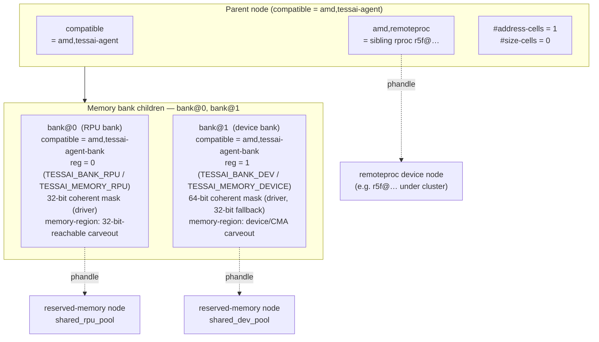

# Device-tree binding: `amd,tessai-agent`

This document describes how the `tessai-agent` driver is wired into a
SoC's device tree. The machine-checkable schema lives at
[`Documentation/devicetree/bindings/accel/amd,tessai-agent.yaml`](../Documentation/devicetree/bindings/accel/amd,tessai-agent.yaml)
and is the source of truth; this page is a friendlier
prose-and-diagram reference.

---

## 1. At a glance



Upstream-friendly placement (**Versal / Telluride** using Xilinx **`xlnx,zynqmp-r5f`**
remoteproc): keep **`amd,tessai-agent` as a sibling** of the **`r5f@…`**
remoteproc node under the soc / platform bus, and tie them with **`amd,remoteproc`**.

A binding instance always has:

- **One** parent node with `compatible = "amd,tessai-agent"` and an
  `amd,remoteproc` phandle pointing at the RPU's remoteproc DT node.

- **Two** child nodes (**`bank@0`** and **`bank@1`**)—logical DMA heaps backing
  GEM allocation for (**a**) firmware-visible / RPU 32-bit memory and (**b**) a
  broader device-visible bank. Both carry the **same** compatible
  **`amd,tessai-agent-bank`**; the role is encoded by the logical-index
  **`reg`** cell. The reg value is the kernel slot index
  (`tdev->banks[reg]`) and is also the matching UAPI `TESSAI_MEMORY_*`
  identifier.

The driver allocates buffers mapped for remote firmware DMA and accelerator-side DMA,
and forwards opaque control payloads to firmware over the **`tessai-agent`** RPMsg
virtio channel on that processor.

Multiple SoC instances (**one remoteproc each**) instantiate multiple
`tessai-agent` nodes (`amd,remoteproc` disambiguates). See [`architecture.md`](architecture.md).

---

## 2. Parent node properties

| Property | Type | Required | Description |
|----------|------|:-------:|-------------|
| `compatible` | string | yes | Must be `"amd,tessai-agent"`. |
| `amd,remoteproc` | phandle | yes | Phandle of the remoteproc node whose firmware advertises the `tessai-agent` RPMsg endpoint. Used to pair each DRM instance with the correct channel in multi-core systems (see [`architecture.md` §3](architecture.md#3-multiple-instances-two-driver-halves-each)). |

**Required on parent:**

| Property | Value | Why |
|---|---|---|
| `#address-cells` | `<1>` | Children carry a single-cell logical-index `reg`. |
| `#size-cells` | `<0>` | Children have no size — `reg` is an index, not a window. |

**`dma-ranges`** is omitted: memory placement comes from each bank's
**`memory-region`**, and per-bank dma-mask width is enforced in the
tessai-agent kernel driver (32 vs 64‑bit coherent) after
**`of_dma_configure()`**.

**Per-bank `compatible`:** required. Each bank child carries the
**single shared** compatible **`amd,tessai-agent-bank`**, so the parent
driver can use **`devm_of_platform_populate()`** (the upstream-preferred path)
to bind both children against one bank `platform_driver`.

**Per-bank `reg`:** required, **logical index only** (not MMIO). The reg
value selects the bank role and matches the kernel `enum tessai_bank_index`
and the UAPI `TESSAI_MEMORY_*` enum:

| `reg` | Role | Driver enum | UAPI enum |
|:----:|------|-------------|-----------|
| `0` | RPU-facing (32-bit) | `TESSAI_BANK_RPU` | `TESSAI_MEMORY_RPU` |
| `1` | Device-facing (64-bit) | `TESSAI_BANK_DEV` | `TESSAI_MEMORY_DEVICE` |

Today the binding requires exactly one of each (`bank@0`, `bank@1`); the
schema may be extended on future SoCs.

---

## 3. Memory bank children (`bank@0`, `bank@1`)

The parent **requires** exactly these two DT children. They share one
`compatible` so a single bank `platform_driver` matches both, and a
mandatory `reg` cell selects the role.

| Subnode | Required `compatible` | Required `reg` | Driver slot | UAPI |
|---------|----------------------|---|-------------|------|
| `bank@0` | **`amd,tessai-agent-bank`** | `<0>` | `TESSAI_BANK_RPU` (32-bit mask) | `TESSAI_MEMORY_RPU` |
| `bank@1` | **`amd,tessai-agent-bank`** | `<1>` | `TESSAI_BANK_DEV` (64-bit mask, fallback 32) | `TESSAI_MEMORY_DEVICE` |

`reg` is a **logical bank index only** — it is not an MMIO base. Buffer
placement is driven by **`memory-region`** (the reserved-memory node's own
`reg`), and the driver enforces coherent **`dma-mask`** widths.

**`dma-coherent` is intentionally not used.** GEM allocations on these heaps must
be **non-cacheable normal memory** — `dma_alloc_coherent()` returns
non-cacheable mappings when the device is **not** marked coherent, matching the
RPU/device DMA path which does not snoop CPU caches.

| Property | Type | Required | Description |
|----------|------|:-------:|-------------|
| `compatible` | string | yes | Must be `"amd,tessai-agent-bank"` for both children. |
| `reg` | u32 | yes | Logical bank index. `0` for the RPU bank, `1` for the device bank. Range bounded by the schema and re-checked by the driver. |
| `memory-region` | phandle | no | Reserved-memory (`shared-dma-pool`) or CMA-visible pool powering `dma_alloc_coherent()` for this bank heap. Omit to use ordinary default heaps. |
| `iommus` | phandle-array | no | SMMU stream(s) for the bank's `struct device`. Present on platforms with IOMMU, omitted otherwise. The same driver code handles both configurations. |

Probe sequence:

1. The parent's `platform_driver` (matching `amd,tessai-agent`) calls
   **`platform_set_drvdata()`** then **`devm_of_platform_populate()`**.
2. The OF core walks each child and creates a `platform_device`; because the
   bank `platform_driver` is **already registered** (init order in the module),
   each bank probes **synchronously** before populate returns.
3. Bank probe reads `reg` (the bank index), validates it is in
   `[0, TESSAI_NUM_BANKS - 1]`, calls
   `of_reserved_mem_device_init_by_idx()`, then
   `dma_coerce_mask_and_coherent()` (32-bit when `reg == TESSAI_BANK_RPU`,
   64-bit-with-fallback otherwise), and registers itself into
   `tdev->banks[reg]`.
4. After populate returns, the parent verifies both bank slots are present and
   then registers the DRM render node.

---

## 4. Reserved-memory companion nodes

Each bank's `memory-region` points at a `shared-dma-pool` reserved-memory
region declared at the root of the DT, for example:

```dts
reserved-memory {
    #address-cells = <2>;
    #size-cells = <2>;
    ranges;

    /*
     * Pool for the RPU bank: must live below 4 GiB so the R5F
     * (which only emits 32-bit bus addresses) can reach it.
     */
    shared_rpu_pool: shared-rpu-pool@70000000 {
        compatible = "shared-dma-pool";
        reg = <0x0 0x70000000 0x0 0x10000000>; /* 256 MiB */
        no-map;
    };

    /*
     * Pool for the dev bank: can live anywhere in the 64-bit window;
     * usually placed above 4 GiB to leave the low 4 GiB for legacy
     * masters.
     */
    shared_dev_pool: shared-dev-pool@800000000 {
        compatible = "shared-dma-pool";
        reg = <0x8 0x00000000 0x0 0x40000000>; /* 1 GiB */
        no-map;
    };
};
```

A few notes on these regions:

- **`no-map`** is recommended so the kernel does not establish a CPU
  linear mapping for the reserved bytes; the driver then mmaps them on
  demand via `dma_mmap_coherent()`.
- The pool is **dedicated**: it must not be used by any other driver.
- Sizes are SoC-dependent; they place a hard cap on the total live
  buffer size per bank. Typical values range from 64 MiB (small
  inference) to several GiB (high-resolution preprocessing pipelines).

---

## 5. Annotated example

```dts
/dts-v1/;
/ {
    #address-cells = <2>;
    #size-cells = <2>;

    /* ---------------- reserved-memory pools ---------------- */
    reserved-memory {
        #address-cells = <2>;
        #size-cells = <2>;
        ranges;

        shared_rpu_pool: shared-rpu-pool@70000000 {
            compatible = "shared-dma-pool";
            reg = <0x0 0x70000000 0x0 0x10000000>;
            no-map;
        };
        shared_dev_pool: shared-dev-pool@800000000 {
            compatible = "shared-dma-pool";
            reg = <0x8 0x00000000 0x0 0x40000000>;
            no-map;
        };
    };

    /* Vendor RPU remoteproc (Xilinx-compatible string substituted per SoC) */
    r5f_0: r5f@ff9a0000 {
        compatible = "xlnx,zynqmp-r5f";
        reg = <0x0 0xff9a0000 0x0 0x10000>;
        /* clocks, resets, firmware-name, … */
    };

    /* ---------------- tessai-agent sibling instance ---------------- */
    tessai_agent_0: tessai-agent {
        compatible = "amd,tessai-agent";
        amd,remoteproc = <&r5f_0>;

        #address-cells = <1>;
        #size-cells    = <0>;

        /*
         * RPU-visible heap — driver coerces 32-bit coherent dma-mask.
         * reg = <0> matches TESSAI_BANK_RPU and TESSAI_MEMORY_RPU.
         */
        npu_bank_rpu: bank@0 {
            compatible    = "amd,tessai-agent-bank";
            reg           = <0>;
            memory-region = <&shared_rpu_pool>;
        };

        /*
         * Device-side accelerator heap — prefers 64-bit mask (falls back to 32).
         * reg = <1> matches TESSAI_BANK_DEV and TESSAI_MEMORY_DEVICE.
         */
        npu_bank_dev: bank@1 {
            compatible    = "amd,tessai-agent-bank";
            reg           = <1>;
            memory-region = <&shared_dev_pool>;
        };
    };
};
```

---

## 6. Multi-RPU example

For SoCs with two R5Fs each running distinct firmware payloads:

```dts
r5f_0: r5f@ff9a0000 { compatible = "xlnx,zynqmp-r5f"; };
r5f_1: r5f@ff9b0000 { compatible = "xlnx,zynqmp-r5f"; };

tessai_agent_0: tessai-agent {
    compatible = "amd,tessai-agent";
    amd,remoteproc = <&r5f_0>;

    #address-cells = <1>;
    #size-cells    = <0>;

    bank@0 {
        compatible    = "amd,tessai-agent-bank";
        reg           = <0>;
        memory-region = <&pool_rpu_0>;
    };
    bank@1 {
        compatible    = "amd,tessai-agent-bank";
        reg           = <1>;
        memory-region = <&pool_dev_0>;
    };
};

tessai_agent_1: tessai-agent {
    compatible = "amd,tessai-agent";
    amd,remoteproc = <&r5f_1>;

    #address-cells = <1>;
    #size-cells    = <0>;

    bank@0 {
        compatible    = "amd,tessai-agent-bank";
        reg           = <0>;
        memory-region = <&pool_rpu_1>;
    };
    bank@1 {
        compatible    = "amd,tessai-agent-bank";
        reg           = <1>;
        memory-region = <&pool_dev_1>;
    };
};
```

Each instance shows up as its own DRM render node
(`/dev/dri/renderD128`, `/dev/dri/renderD129`, …) bound to the **`amd,tessai-agent`**
platform probe; **`amd,remoteproc`** routes RPMsg to the pairing selected above.

[`architecture.md` §3](architecture.md#3-multiple-instances-two-driver-halves-each).

---

## 7. Validating a DT

If you have `dtschema` installed, you can validate against the YAML
schema directly:

```bash
# Check the schema itself parses cleanly
dt-validate -m Documentation/devicetree/bindings/accel/amd,tessai-agent.yaml

# Validate a compiled DTB
dt-validate -s Documentation/devicetree/bindings/accel/amd,tessai-agent.yaml \
    /path/to/your.dtb
```

When using the in-kernel validator (`make dtbs_check`), drop the YAML
into the kernel tree at the same path and it will be picked up
automatically.

---

## 8. Common pitfalls

- **`TESSAI_MEMORY_RPU` without an RPU-aligned carveout.** On VEK385, `boards/vek385/amdxdna-merge-tessai-agent-dts.py` injects **`tess_rpu_mgmt_ddr`** (`shared-dma-pool`, PA **`0x098b0000`**, **4 MiB**, after virtio **`~0x098AE000`**). The **`bank@0`** subnode needs **`memory-region = <&tess_rpu_mgmt_ddr>`**. RPU firmware must agree on the PA span (`tess_rpu_gem_carveout`). Otherwise GEM alloc fails (`-ENXIO`) or the core faults when firmware trusts **`dma_addr`**.
- **Wrong `reg` for the role.** `bank@0` must have `reg = <0>` (RPU) and `bank@1` must have `reg = <1>` (device). Swapping them silently mis-routes 64-bit GEMs into the 32-bit heap (or vice versa). The schema pins `reg` per node name and the driver re-checks at probe.
- **Stale DTS using two separate compatibles** (`amd,tessai-agent-rpu-bank` / `-dev-bank`) **or no `reg`/unit-address.** Older drafts are deprecated; the schema and driver no longer accept them. Use the single shared `amd,tessai-agent-bank` compatible plus `reg`.
- **Sharing one reserved-memory pool between both banks.** The driver attaches each heap to separate `struct device`; sharing defeats per-bank `dma-mask`.
- **`no-map` vs CMA coexistence.** Heaps meant to coexist with contiguous allocator behaviour follow generic reserved-memory **`reusable`** / **`linux,cma-default`** rules—see **`shared-dma-pool`** binding.
- **Wrong `amd,remoteproc` target.** Confirm runtime logs tying RPMsg bind to expected remoteproc **`%pOF`** path.

---

## 9. See also

- [`architecture.md`](architecture.md) — runtime behaviour (`platform_driver`,
  `rpmsg_driver`, GEM banks).
- [`buffer-management.md`](buffer-management.md) — userspace bank selection (`TESSAI_MEMORY_*`).
- Upstream **`shared-dma-pool`** binding.
