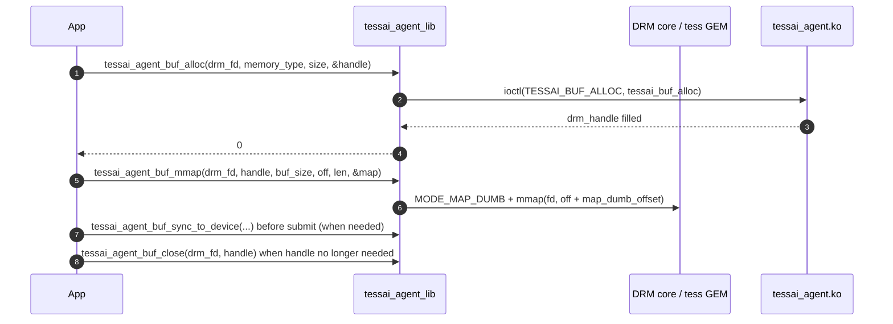
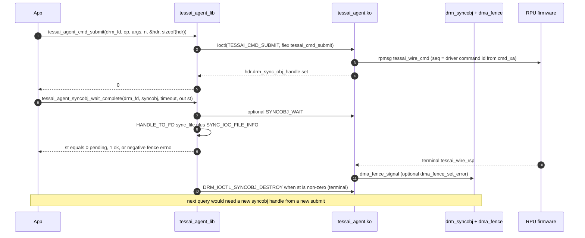
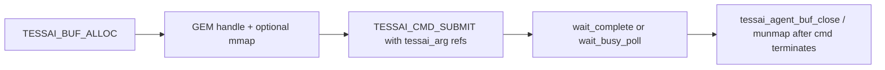

# Userspace library API flow (`libtessai_agent`)

This page matches the **installed** helpers in
[`lib/include/tessai_agent/tessai_agent_lib.h`](../lib/include/tessai_agent/tessai_agent_lib.h)
and
[`lib/src/tessai_agent_lib.c`](../lib/src/tessai_agent_lib.c).
The **ABI** (structs, ioctl numbers) lives in
[`include/uapi/tessai-agent/tessai_agent.h`](../include/uapi/tessai-agent/tessai_agent.h).

Applications may call **raw ioctls** instead; the library only reduces
boilerplate (buffer packing, timed **`DRM_SYNCOBJ_WAIT`**, **`SYNC_IOC_FILE_INFO`**
probes, automatic **`DRM_IOCTL_SYNCOBJ_DESTROY`** on terminal fence from
**`…_wait_complete`** / **`…_wait_busy_poll`**).

**Prerequisite:** open the correct DRM render node (`open("/dev/dri/renderDn", …)`)
whose driver name matches `TESSAI_AGENT_DRIVER_NAME` (`"tessai_agent"`), usually
via `drmGetVersion()` or `drmGetDevices2()`.

See also [`buffer-management.md`](buffer-management.md) and
[`commands.md`](commands.md) for kernel-side behavior.

---

## 1. Buffer flow (allocation / mmap / release)

Allocate with **`tessai_agent_buf_alloc()`** (`TESSAI_BUF_ALLOC`). Map with
**`tessai_agent_buf_mmap()`** (page-aligned offset/length; partial ranges OK) or
the raw **`DRM_IOCTL_MODE_MAP_DUMB`** + **`mmap`** path on a **card** fd.
Before device DMA reads CPU-written data (and after device DMA writes data the
CPU will read), call **`tessai_agent_buf_sync()`** or the
**`tessai_agent_buf_sync_to_device()`** / **`…_from_device()`** helpers
(**`TESSAI_BUF_SYNC`**; see [buffer-management §3](buffer-management.md#3-cache-sync-tessai_buf_sync)).

When the CPU no longer needs the handle, call **`tessai_agent_buf_close()`** —
a thin wrapper around **`DRM_IOCTL_GEM_CLOSE`**. If a submitted command still
pins the GEM, the object stays alive until that command completes (see
[buffer-management §5](buffer-management.md#5-in-flight-command-pins)).



| `memory_type` | Bank | Typical use |
|----------------|------|----------------|
| `TESSAI_MEMORY_RPU` (`0`) | `bank@0` (`TESSAI_BANK_RPU`) | R5F-accessible DDR carveout for firmware |
| `TESSAI_MEMORY_DEVICE` (`1`, `TESSAI_MEMORY_DEFAULT`) | `bank@1` (`TESSAI_BANK_DEV`) | Default 64-bit device pool. On VEK385 this is `buffer@50000000000` (4 GiB high-DDR reusable CMA pool at PA `0x500_0000_0000`), bound by numeric phandle `<0x01>` because the official Versal-net base DT leaves the pool unlabeled. Does **not** carry `linux,cma-default` — exclusive to consumers that bind it explicitly. |

---

## 2. Command flow (submit → wait → status)

Submit with **`tessai_agent_cmd_submit()`**, which builds a **`struct tessai_cmd_submit`**
(header + `args[]`), zeroes **`drm_sync_obj_handle`** on entry, and issues
**`TESSAI_CMD_SUBMIT`**. On success **`hdr_out->drm_sync_obj_handle`** is the binary
syncobj handle for that submission.

**Waiting and completion** — public surface (blocking **`DRM_IOCTL_SYNCOBJ_WAIT`**
is **not** exported as its own symbol; only used inside **`wait_complete`**):

| API | Role |
|-----|------|
| **`tessai_agent_syncobj_wait_complete()`** | Relative timeout: probe (`timeout_ns == 0`), bounded wait (`timeout_ns > 0`), or sleep until deadline then **fence status**. When the fence reports a **terminal** state (`*out_wait_status != 0`), the library issues **`DRM_IOCTL_SYNCOBJ_DESTROY`** on that syncobj so the per-submit object does not linger. |
| **`tessai_agent_syncobj_wait_busy_poll()`** | Polling loop using **`fence_status`** until signaled, wall cap, or error. On first **non-pending** status (`*out_fence_status != 0`), invokes the same **`SYNCOBJ_DESTROY`** path as **`wait_complete`**. |
| **`tessai_agent_syncobj_fence_status()`** | **Non-blocking** probe only — **does not** destroy the syncobj (for custom polling). |
| **`tessai_agent_syncobj_to_fence_fd()`** | One-shot **sync_file** for **`poll(2)` / `epoll`**. Does **not** destroy the submit syncobj; complete the wait path with **`wait_complete`** / **`wait_busy_poll`**, or manage the handle yourself. |

While the reported fence status stays **0** (pending), **`wait_complete`** and
**`wait_busy_poll`** leave the syncobj handle valid. After the driver signals
completion (success or error class), the library tears down the syncobj handle
for both helpers.

### 2.1 Typical patterns

```text
Bounded wait + status     tessai_agent_syncobj_wait_complete(drm_fd, h, rel_ns, &st)
Probe once                tessai_agent_syncobj_wait_complete(drm_fd, h, 0, &st)
Sleeping poll loop        tessai_agent_syncobj_wait_busy_poll(..., interval_ns > 0)
Cooperative tight poll    tessai_agent_syncobj_wait_busy_poll(..., interval_ns == 0)
Block on fd               tessai_agent_syncobj_to_fence_fd + poll() then wait_complete
```

For an **unbounded** wait without spinning, use **`wait_busy_poll`** with
**`max_wall_ns < 0`** and a non-zero **`interval_ns`** (or pass a very large
**`timeout_ns`** to **`wait_complete`**).



---

## 3. Putting buffers and commands together

Typical **`tessai_arg`** usage:

- Scalar parameter: **`size == 0`**, set **`value`**.
- GEM slice passed to firmware: **`size > 0`**, **`bo.drm_buffer_handle`** +
  **`bo.offset`**; kernel replaces with **`dma_addr + offset`** on the wire.
  **`size`** must cover the bytes the firmware will touch (validated against the
  GEM object size).

**Six-argument command** (input tag + size + BO, then output tag + size + BO) —
see **`OP_CODE_CMD0`** in
[`include/uapi/tessai-agent/tessai_agent.h`](../include/uapi/tessai-agent/tessai_agent.h)
and [commands.md §4](commands.md#example-op_code_cmd0-with-inputoutput-bos):

```c
struct tessai_arg args[6] = { /* INPUT_BO, SZ_16M, bo0 slice, OUTPUT_BO, SZ_8M, bo1 */ };
struct tessai_cmd_submit hdr;

memset(&hdr, 0, sizeof(hdr));
if (tessai_agent_cmd_submit(drm_fd, OP_CODE_CMD0, args, 6, &hdr, sizeof(hdr)))
	...;
tessai_agent_syncobj_wait_complete(drm_fd, hdr.drm_sync_obj_handle, timeout_ns, &st);
```



For runnable examples covering every UAPI op (buf_alloc, cmd_submit,
lifecycle, fw_echo writeback, and the full fault-class fence-error
suite) see
[`lib/examples/tessai_agent_test.c`](../lib/examples/tessai_agent_test.c).
