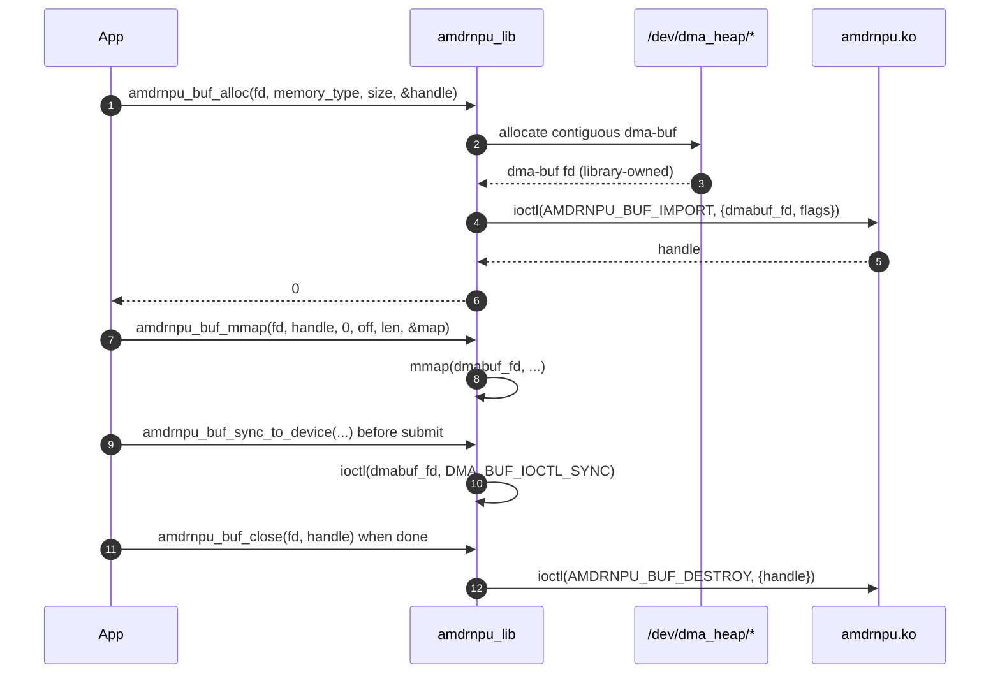
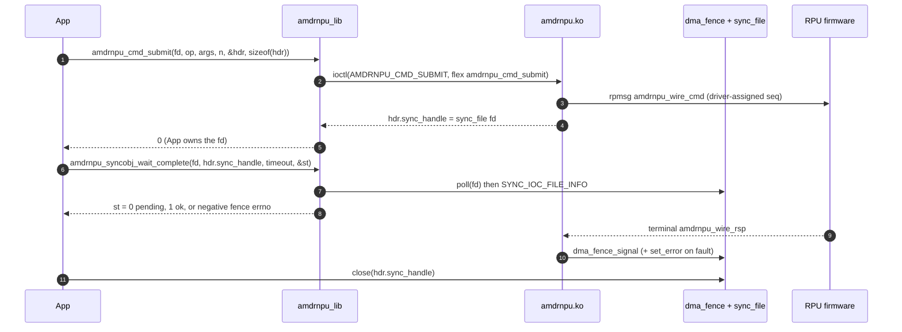
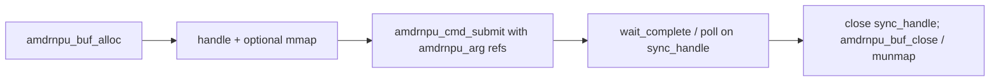

# Userspace library API flow (`libamdrnpu`)

This page matches the **installed** helpers in
[`lib/include/amdrnpu/amdrnpu_lib.h`](../lib/include/amdrnpu/amdrnpu_lib.h)
and
[`lib/src/amdrnpu_lib.c`](../lib/src/amdrnpu_lib.c).
The **ABI** (structs, ioctl numbers) lives in
[`include/uapi/amdrnpu/amdrnpu.h`](../include/uapi/amdrnpu/amdrnpu.h).

Applications may call **raw ioctls** instead; the library only reduces
boilerplate (dma-buf-heap allocation, buffer packing, `sync_file`
waiting via `poll(2)` / `SYNC_IOC_FILE_INFO`, and cache maintenance via
`DMA_BUF_IOCTL_SYNC`). The library uses **no libdrm** — it talks to the
char device and dma-buf/dma-heap/sync_file interfaces directly.

> **Frozen ABI.** The public function signatures are a stable interface;
> existing callers depend on them, so arity and types do not change.
> Because the driver moved from a DRM device to an rpmsg char device,
> some parameters that only made sense for the old DRM/GEM model are now
> **reserved** (documented as ignored). The names are historical:
> `syncobj_handle` is really a `sync_file` fd, and the `fd` argument to
> the wait/status helpers is ignored (the fd carries the state).

**Prerequisite:** open the device node,
`open("/dev/amdrnpu.N", O_RDWR | O_CLOEXEC)`. There is no name/version
ioctl to probe — the node name *is* the identity — so discovery is a
scan of `/dev/amdrnpu.*` (see the example programs under
[`lib/examples/`](../lib/examples/)).

See also [`buffer-management.md`](buffer-management.md) and
[`commands.md`](commands.md) for kernel-side behavior.

---

## 1. Buffer flow (allocate / map / sync / release)

**`amdrnpu_buf_alloc()`** allocates a dma-buf from the heap that matches
`memory_type` and imports it (`AMDRNPU_BUF_IMPORT`) in one step,
returning an opaque handle. Map it with **`amdrnpu_buf_mmap()`**
(page-aligned offset/length; `offset == 0`, `length == 0` maps the whole
buffer) and unmap with **`amdrnpu_buf_munmap()`** — both operate on the
buffer's **dma-buf**, not the device node.

Before device DMA reads CPU-written data (and after device DMA writes
data the CPU will read), call **`amdrnpu_buf_sync()`** or the
**`amdrnpu_buf_sync_to_device()`** / **`…_from_device()`** helpers, which
issue `DMA_BUF_IOCTL_SYNC` on the dma-buf.

Release the handle with **`amdrnpu_buf_close()`** (`AMDRNPU_BUF_DESTROY`
+ closing the library-owned dma-buf fd). If a submitted command still
references the buffer, the backing memory stays alive until that command
completes (see
[buffer-management §4](buffer-management.md#4-in-flight-command-pins)).



| `memory_type` | Domain / import flag | Typical use |
|----------------|----------------------|----------------|
| `AMDRNPU_MEMORY_RPU` (`0`) | RPU heap, imported `AMDRNPU_BUF_IMPORT_FW` | firmware-visible buffers the RPU dereferences |
| `AMDRNPU_MEMORY_DEVICE` (`1`, `AMDRNPU_MEMORY_DEFAULT`) | device heap, imported `AMDRNPU_BUF_IMPORT_DEVICE` | accelerator/device-visible buffers (default) |

---

## 2. Command flow (submit → wait → status)

Submit with **`amdrnpu_cmd_submit()`**, which builds a
`struct amdrnpu_cmd_submit` (header + `args[]`), zeroes `sync_handle` on
entry, and issues `AMDRNPU_CMD_SUBMIT`. On success
**`hdr_out->sync_handle`** is a **`sync_file` fd** the caller owns and
must eventually `close(2)`.

**Waiting and completion** — public surface:

| API | Role |
|-----|------|
| **`amdrnpu_syncobj_wait_complete()`** | Relative timeout: `timeout_ns == 0` probes, `> 0` waits up to that many nanoseconds, `< 0` is rejected (`-EINVAL`). Writes `0` (pending), `1` (completed OK), or a negative fence errno. Returns `-ETIMEDOUT` if the deadline passed while pending. Does **not** close the fd. |
| **`amdrnpu_syncobj_fence_status()`** | **Non-blocking** probe via `SYNC_IOC_FILE_INFO` (`>0` signalled, `0` pending, `<0` errno). Safe in a polling loop; does not close the fd. |
| **`amdrnpu_syncobj_to_fence_fd()`** | Returns an independent `dup`'d (`F_DUPFD_CLOEXEC`) fence fd for a blocking `poll(2)` / `epoll`. Caller closes it. |
| **`amdrnpu_syncobj_wait_busy_poll()`** | **OBSOLETE** — delegates to `amdrnpu_syncobj_wait_complete()` (`max_wall_ns` → `timeout_ns`; `interval_ns` ignored). |

Because `sync_handle` is a real fd, the most direct wait is a plain
`poll(2)` for `POLLIN`.

### 2.1 Typical patterns

```text
Bounded wait + status   amdrnpu_syncobj_wait_complete(fd, h, rel_ns, &st)
Probe once              amdrnpu_syncobj_wait_complete(fd, h, 0, &st)
Effectively unbounded    amdrnpu_syncobj_wait_complete(fd, h, INT64_MAX, &st)
Block on the fd          poll(&(struct pollfd){ .fd = h, .events = POLLIN }, 1, -1)
Independent poll fd      amdrnpu_syncobj_to_fence_fd(fd, h, &pfd) then poll(pfd)
```



---

## 3. Putting buffers and commands together

Typical **`amdrnpu_arg`** usage:

- **Scalar** parameter: `size == 0`, set `value`.
- **Buffer** slice passed to firmware: `size != 0`, set
  `bo.buffer_handle` (from `amdrnpu_buf_alloc()`) + `bo.offset`; the
  kernel emits `dma_addr + offset` on the wire. `size` must cover the
  bytes the firmware touches (validated against the buffer size).

**Six-argument command** (input tag + size + buffer, then output tag +
size + buffer) — see `OP_CODE_CMD0` in
[commands.md §4](commands.md#example-op_code_cmd0-with-inputoutput-buffers):

```c
struct amdrnpu_arg args[6] = { /* INPUT_BO, SZ_16M, bo0 slice, OUTPUT_BO, SZ_8M, bo1 */ };
struct amdrnpu_cmd_submit hdr;
int32_t st = 0;

memset(&hdr, 0, sizeof(hdr));
if (amdrnpu_cmd_submit(fd, OP_CODE_CMD0, args, 6, &hdr, sizeof(hdr)))
	...;
amdrnpu_syncobj_wait_complete(fd, (uint32_t)hdr.sync_handle, timeout_ns, &st);
close(hdr.sync_handle);
```



For runnable examples covering buffer alloc, cmd_submit, the firmware
echo writeback flow, and latency/XRT flows, see the programs under
[`lib/examples/`](../lib/examples/) (e.g.
[`amdrnpu_test.c`](../lib/examples/amdrnpu_test.c)).
